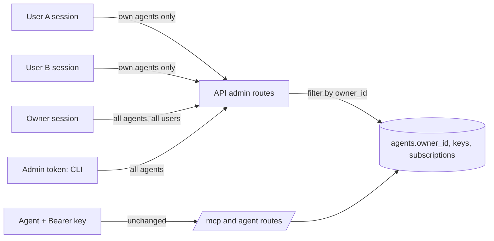

# agent-ownership — Spec (M2d: agents belong to the user who created them)

Status: init approved 2026-10-28 (revised same day: owner sees all, every user manages own agents) · design approved 2026-10-28 ([ADR-0023](../../adr/0023-agent-ownership-by-scope-filter.md)) · implemented and verified 2026-10-28 (pass with follow-ups, see [verify.md](verify.md))

## 0. Review guide

**In three lines:** today every agent is a shared system object: any admin or owner sees and manages all of them, nothing records who made one, and only admin and owner may create agents. This spec records a **creator on every agent** and applies one data rule: **a user sees and manages only the data that belongs to them; the `owner` role sees all users and all agents**. Every signed-in user, including the default `viewer`, can create and manage their own agents. Agent keys, cursors, MCP and the agent-facing routes do not change.



**Review order:** §0 decisions → §4 scope → §6 ACs → risks.

### Decisions

| ID | Decision | Status |
|---|---|---|
| D-1 | Ownership model | Decided: per-user ownership, roles kept (user choice 2026-10-28: "option 1"; workspaces and simplified roles go to the backlog) |
| D-2 | Data rule | Decided: a user sees and manages only data that belongs to them; the `owner` role sees all users and all agents (user, 2026-10-28: "admin can see all the users and agents, user can see the data belonging to himself only"; "admin" mapped to the `owner` role by user choice). **Replaces the earlier "no role overrides" draft** |
| D-3 | Who may manage agents | Decided: every signed-in user (`owner`, `admin`, `viewer`) manages their own agents and their subscriptions (user choice 2026-10-28). Changes the ui-login D-4 permission table: `manage_agents` now includes `viewer` |
| D-4 | Agents with no creator | Decided: existing agents (`demo-financial`, `push-live`), `make agent-create` agents and orphans are visible to and manageable by the `owner` role and the admin token only; `admin` and `viewer` never see them (user choice 2026-10-28) |
| D-5 | Subscriptions | Decided: follow the agent. A user sees and deletes only subscriptions of agents they may see; `owner` sees all (user choice 2026-10-28) |
| D-6 | Deleting a user | Decided: their agents become ownerless and keep working (FK `ON DELETE SET NULL`; user choice 2026-10-28). The owner can then manage them (D-4) |
| D-7 | Roles | Decided **[assumption]**: the three roles stay. With D-3, `admin` and `viewer` have identical permissions; only `owner` differs (user management and see-all). Collapsing them is in the backlog, not done here |
| D-8 | Agent names | Decided **[assumption]**: still globally unique (the name identifies the agent in analyses and the MCP identity); a taken name returns 409 whoever owns it, which can reveal that a name exists. Accepted |
| D-9 | Other data | Decided **[assumption]**: articles, stories and analyses read through articles are shared public GDELT data and stay visible to every signed-in user; the live feed is unchanged; a user's own account data is what `/api/auth/me` returns; only `owner` lists users (as today) |

No open decisions.

### Open risks
1. **`admin` is now redundant.** After D-3 it has the same permissions as `viewer`. It stays as a no-op role until a later cleanup (backlog), which can confuse readers of the Users screen and the docs.
2. **Open sign-up now grants a capability.** Today an anonymous visitor who signs up can only read articles; after D-3 they can also create agents and API keys (which can read articles and write analyses through `/mcp`). Mitigations: strict per-user isolation, `auth_signup_open: false`, and the existing agent rate limit. The sign-up rate limit is still a P2 backlog item and becomes more relevant.
3. **Name existence leak (D-8):** a user can probe whether an agent name exists by trying to create it.
4. **Authorization by filter:** every agent and subscription route must check ownership. A forgotten check leaks another user's agent or key issuance. Mitigation: one owner filter in the repo and a test per route (AC-4, AC-7).
5. **Roles without a scope** (observed 2026-10-28): there is no workspace concept, so roles stay thin. Workspaces are in the backlog (P2).

Prerequisites the user owns: none.

## 1. Problem

Agents are system-level rows with no creator. Every admin and owner sees every agent, key prefix, subscription and `last_used_at`, and can revoke another person's key; a plain user cannot register an agent at all. A newly promoted admin opens the Agents page and finds agents they never created (`demo-financial`, `push-live`).

## 2. Goals and how they are measured

| Goal | Measure |
|---|---|
| A user sees only agents they created; the owner sees all | AC-3, AC-5 |
| A user cannot touch another user's agent, key or subscription | AC-4, AC-7 |
| Every signed-in user can manage their own agents | AC-9 |
| Deleting a user does not stop their agents | AC-8 |
| Running agents, the CLI and user management keep working | AC-1, AC-6, AC-10 |

Learning goal: authorization by resource ownership (row-level filtering, 404-not-403 to avoid existence leaks, an all-seeing role) and a safe additive migration.

## 3. Data and reality findings

- `agents` has no owner column: `id`, `name` (unique), `status`, `created_at` (`packages/db/src/newsdock_db/models.py:138`) **[verified]**.
- `AgentsRepo.create_agent(name, key)` takes no user; `list_agents()` returns all agents and all keys (`apps/api/src/newsdock_api/adapters/agents_repo.py`) **[verified]**.
- Admin routes sit under one `require_admin` dependency returning a `Principal`, but no route reads it to filter (`adapters/admin.py`) **[verified]**.
- `issue_key` checks existence through `registry.list_agents()`, so it must change with the list filter **[verified]**.
- Subscriptions are listed and deleted globally through `list_all` and `delete_any` (`adapters/subscriptions_repo.py`) **[verified]**.
- `manage_agents` is held by `owner` and `admin` only (`domain/accounts.py` PERMISSIONS) **[verified]**; the Agents and Subscriptions pages and nav are gated by role in the web (`features/auth/roles.ts`) **[verified]**.
- The admin token principal has no user id, so it cannot own anything; agents it creates are ownerless (D-4) **[verified]**.
- Local data: `demo-financial` and `push-live` exist and will be ownerless after migration (seen in the UI by the user, 2026-10-28).

## 4. Scope of this milestone (walking skeleton)

**In**
- Migration 0007: `agents.owner_id` nullable FK → `users.id` `ON DELETE SET NULL`, indexed. Existing rows stay NULL.
- API: a session creates agents with `owner_id`; `/api/admin/agents*` and `/api/admin/subscriptions*` are open to every signed-in user and filtered by the session user (`owner` and the admin token unfiltered); other users' and ownerless resources return 404 to non-owner sessions. The admin token keeps full reach.
- Permission table: `manage_agents` includes `viewer`.
- Web: Agents and Subscriptions pages and nav links appear for every signed-in user and show only the rows the API returns (empty-state sentence); the owner's list shows who owns each agent.
- Docs updated in the same change: CLAUDE.md (accounts, roles), README (orphan agents, CLI), ADR-0016/0020 amendments, ui-login D-4 note, roadmap.

**Out**
- Workspaces, sharing, transferring agents, adopting orphans through a dedicated UI action, `OWNER=` on the CLI (all backlog).
- Removing or merging roles.
- Any change to agent keys, `/mcp`, agent cursors, rate limits, agent-facing subscription routes, SSE or the live feed.
- Per-user quotas, audit log.

## 5. Users and key flows

- **Any signed-in user** (`viewer`, `admin`, `owner`) opens Agents: sees only their own agents (empty on first visit), creates one (key shown once as today), manages its keys and subscriptions. Other users' agents never appear.
- **Owner**: sees every agent (with its creator, or "no owner") and every user; can disable, re-key or revoke any agent, including legacy and orphaned ones.
- **Operator** with the admin token: `make agent-create` makes an ownerless agent; token calls to `/api/admin/*` see and manage every agent.
- **Running agent**: authenticates with its key exactly as before, owned or not.
- **Account removed**: its agents stay active but become ownerless, then the owner manages them.

## 6. Acceptance criteria

```
AC-1  Migration adds ownership without touching data
  Given a database at revision 0006 with agents demo-financial and push-live and existing keys
  When  migration 0007 runs
  Then  agents.owner_id exists and is NULL for both agents, and their keys still authenticate
  Verify: auto

AC-2  A session-created agent records its creator
  Given user A (role viewer) is logged in
  When  A creates an agent through the agent route
  Then  the agent's owner is A, and a creation through the admin token leaves the owner empty
  Verify: auto

AC-3  Listing shows only what the caller may see
  Given user A owns agent a1, user B owns agent b1, agent o1 has no owner, and an owner-role user exists
  When  A, then B, then the owner-role user, then the admin token list agents
  Then  A sees only a1, B sees only b1, and the owner-role user and the token each see a1, b1 and o1
  Verify: auto

AC-4  Another user's agent cannot be touched
  Given user A owns agent a1 with a key, and user B (not owner) is logged in
  When  B issues a key for a1, revokes a1's key, disables a1 and enables a1
  Then  every call returns 404, a1 and its keys are unchanged, and the same calls by A, by the owner-role user and by the admin token succeed
  Verify: auto

AC-5  Ownerless agents are visible only to the owner and the token
  Given agent o1 has no owner
  When  a viewer-role user, then an admin-role user, then the owner-role user try to list agents and disable o1 by id
  Then  the first two do not see o1 and get 404 on the disable, the owner-role user sees o1 and can disable and enable it
  Verify: auto

AC-6  Running agents are unaffected
  Given agents a1 (owned) and o1 (ownerless) each have an active key
  When  each agent calls /mcp and its own subscription routes with its key
  Then  both authenticate and behave exactly as before this change, and each agent's own subscriptions and cursor are untouched
  Verify: auto

AC-7  Subscriptions follow agent visibility
  Given a1 (owned by A) and b1 (owned by B) each have a subscription
  When  A lists subscriptions and tries to delete b1's subscription through the admin route
  Then  A sees only a1's subscription, the delete returns 404 and b1's subscription remains, while the owner-role user and the admin token see and can delete both
  Verify: auto

AC-8  Deleting a user orphans their agents
  Given user A owns agent a1 with an active key and the owner removes A
  When  the agent calls /mcp with its key afterwards
  Then  the call succeeds, a1's owner is empty, a1 appears in no non-owner session's list, and it appears in the owner's list as having no owner
  Verify: auto

AC-9  Every signed-in user can manage their own agents
  Given a freshly signed-up user with role viewer
  When  the user creates an agent, lists agents, issues and revokes a key, and creates then deletes a subscription for it
  Then  all calls succeed and touch only that agent; an anonymous caller gets 401 on the same routes
  Verify: auto

AC-10  The CLI and user management still work
  Given the stack is up, NEWSDOCK_ADMIN_TOKEN is set, and users with roles owner, admin and viewer exist
  When  make agent-create NAME=x runs, make user-reset-password EMAIL=<a user> runs, and each user calls the user-management routes
  Then  the agent is created ownerless with its key printed once, the reset succeeds, and only the owner role may list or change users (admin and viewer get 403)
  Verify: auto

AC-11  The web shows what the API returns
  Given the web is built against the API types and the API returns one agent and one subscription for the caller
  When  a viewer opens the Agents and Subscriptions pages
  Then  each renders only the returned rows (an empty-state sentence when none), the nav shows both links for a viewer, and the owner's Agents list additionally shows each agent's creator
  Verify: auto
```

Documentation consistency is part of "done" but is a check, not an AC: `make check` (docs-check, generated types up to date) must pass.

## 7. Non-functional requirements

- Authorization is enforced in the API; the UI hides nothing the API would allow.
- Foreign and unknown ids both return 404 to non-owner sessions (no existence leak by id).
- The migration is additive and runs in `make migrate` on existing data.
- No new secrets; no change to key storage.

## 8. Assumptions

- **[assumption]** The admin token acts as an operator and is exempt from ownership filtering (D-4).
- **[assumption]** The three roles stay; `admin` becomes equivalent to `viewer` (D-7).
- **[assumption]** Agent names stay globally unique (D-8).
- **[assumption]** Articles and the live feed stay shared (D-9).
- **[verified]** Agents authenticate by key and never need a user (`find_key` joins `api_keys` to `agents` only).

## Glossary

- **Owner (of an agent):** the user account that created it, stored as `agents.owner_id`. Not the `owner` role.
- **`owner` role:** the top user role; manages users and sees every user and agent (D-2).
- **Ownerless agent:** an agent with no `owner_id`: created by the CLI/admin token, pre-existing, or orphaned by a deleted user.
- **Admin token:** `NEWSDOCK_ADMIN_TOKEN`, the operator credential for the CLI and `/api/admin/*`; not a user.
- **Orphan:** an ownerless agent whose owner was deleted.
- **Principal:** the resolved caller (agent key, admin token or session user) from `adapters/principal.py`.
