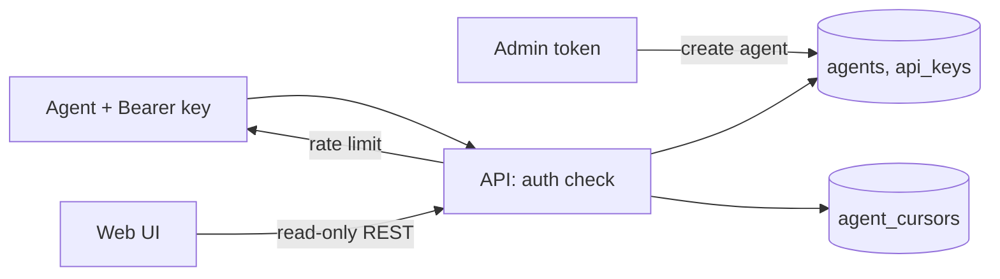

# agent-platform — Spec (Milestone 2, part 1 of 3: agent registry, API keys, per-agent cursors, quotas)

Status: init approved · 2026-10-14

## 0. Review guide

**In three lines:** today anyone who can reach the API reads everything, and the only cursor lives in the demo agent's own volume. This spec adds an **agent registry**: an admin creates agents, each gets an **API key** (stored hashed) that MCP and REST require, the server keeps a **cursor per agent**, and each agent is **rate-limited**. Push delivery and human UI login are the next two specs (D-1).



**Review order:** §0 decisions → §4 scope → §6 ACs → risks.

### Decisions

| ID | Decision | Status |
|---|---|---|
| D-1 | Cut line | Decided: M2 is three sequential specs: `agent-platform` (this) → `push-delivery` → `ui-login`. User asked for "everything" in M2; split recommended and accepted (2026-10-14) |
| D-2 | Agent registration | Decided: admin-issued keys. Admin creates agents with an admin token from `.env`; no self-service (2026-10-14, recommended option; the UI-login spec later replaces the token with accounts) |
| D-3 | Push channel order (for the next spec) | Decided: SSE first, then webhook, then MCP notifications (2026-10-14) |
| D-4 | Human login (for the third spec) | Decided: multi-user accounts + roles (user choice over single-owner, 2026-10-14) |
| D-5 | Auth mode | Decided: `auth.required` config flag, default `true`; the demo agent gets its key from `.env` (2026-10-14) |
| D-6 | Quotas | Decided **[assumption]**: per-agent request rate limit per minute, HTTP 429 with `Retry-After`. Volume/storage quotas deferred. Chosen as the conventional default, not asked |
| D-7 | Web UI access | Decided **[assumption]**: the UI's read-only `GET /api/*` stays open while there is no UI login (the Next.js server holds no key); agents-only auth applies to MCP, `submit_analysis` and cursor routes. Revisited in `ui-login` |
| D-8 | Anonymous rate limit | Decided: with `auth.required=false`, all anonymous traffic shares one rate bucket (2026-10-14, at /spec-design) |

No open decisions.

### Open risks
1. **Open UI reads vs. "auth required" (D-7):** with `auth.required=true` the public read routes stay open for the UI, so keys do not protect article reading until `ui-login`. Mitigation: state it in the README; if the user wants reads locked now, the UI needs a server-side key.
2. **Admin token in `.env` is a single shared secret** until `ui-login`.
3. **Migration of the demo agent:** the file cursor on `agent_state` must move to the server cursor without re-scoring the backlog (or re-scoring is accepted: analyses upsert).
4. **Key leakage in logs:** keys must never be logged; only a short prefix.

### Prerequisites you own
- Choose the admin token and put it in `.env` (never committed). Create the demo agent's key with the admin route/CLI after first `make up`.

## 1. Problem

The dock has no identity: any client can call every MCP tool and REST route, `submit_analysis` takes a free-text `agent_name`, and each agent must remember its own cursor (lost if its volume is lost). Nothing stops one noisy client from hammering the API. Other people cannot be given access safely.

## 2. Goals and how measured

- Every MCP call and `submit_analysis` is tied to a registered agent. Measured by AC-3…AC-6.
- A restarted or re-deployed agent resumes where it stopped without its own storage. Measured by AC-8, AC-9.
- One agent cannot starve the others. Measured by AC-11.
- Learning goals: API-key design (hashing, prefix lookup, constant-time compare), FastAPI/MCP auth middleware, rate limiting, per-tenant state.

## 3. Data/reality

- **[verified]** M1 API has no auth; `submit_analysis(article_id, agent_name, payload)` stores a caller-chosen name (`apps/api/.../http.py`).
- **[verified]** Agent cursor is a JSON file on volume `agent_state` (`apps/agent/.../adapters/cursor.py`); the API's cursor is opaque base64 of `seq` (ADR-0004).
- **[verified]** Migrations are Alembic `0001`–`0003`; new tables are `0004+`.
- **[verified]** MCP is mounted on the same FastAPI app (streamable HTTP, `/mcp`), so one ASGI middleware can cover both.
- **[verified 2026-10-14, T-01]** The MCP Python SDK in use lets an ASGI middleware read the `Authorization` header and expose the agent to tool handlers (e.g. contextvar). Verify in `/spec-design` with a spike.

## 4. Scope of this milestone (walking skeleton)

**In**
- Tables for agents and hashed API keys; admin routes to create, list, disable agents and issue/revoke keys, guarded by the admin token.
- Bearer-key auth on `/mcp` and on mutating/agent REST routes; `auth.required` flag.
- `submit_analysis` records the authenticated agent's name (caller-supplied name is ignored or must match).
- Server-side cursor per agent: stored and resumed via MCP/REST.
- Per-agent request rate limit.
- Demo agent switched to its key and the server cursor; compose/config/docs updated.

**Out (backlog)**
- Saved filters and any push delivery (`push-delivery`); human accounts and roles (`ui-login`); key rotation overlap, scopes, volume quotas, audit log.

## 5. Users and key flows

- **Owner/admin:** creates an agent with the admin token, receives the key once, puts it in the agent's env.
- **Agent:** sends `Authorization: Bearer <key>`; calls `list_new_articles` and acknowledges progress; on restart it resumes from the server cursor.
- **Web UI:** unchanged read-only browsing (D-7).

## 6. Acceptance criteria

```
AC-1  Create agent and key
  Given the admin token is configured
  When  the admin calls the create-agent route with a name
  Then  the response contains an agent id and a plaintext API key exactly once, and the key is not retrievable afterwards
  Verify: auto

AC-2  Keys are stored hashed
  Given an agent with an issued key
  When  the database row for the key is read
  Then  it contains a hash and a short prefix, never the plaintext key
  Verify: auto

AC-3  Missing or wrong key is rejected on MCP
  Given auth.required is true
  When  a client calls any MCP tool with no key, or with an unknown key
  Then  the request fails with 401 and no tool runs
  Verify: auto

AC-4  Valid key is accepted
  Given an active agent with a valid key
  When  it calls search_articles over MCP with that key
  Then  the call succeeds and returns articles
  Verify: auto

AC-5  Revoked or disabled agent is rejected
  Given an agent whose key was revoked (or the agent disabled)
  When  it calls an MCP tool with that key
  Then  the request fails with 401
  Verify: auto

AC-6  Analyses carry the authenticated identity
  Given an authenticated agent "alpha"
  When  it calls submit_analysis with agent_name "beta"
  Then  the stored analysis has agent "alpha"
  Verify: auto

AC-7  Admin routes need the admin token
  Given the admin routes exist
  When  they are called with no token, an agent key, or a wrong token
  Then  each call fails with 401 or 403 and nothing changes
  Verify: auto

AC-8  Server-side cursor resumes
  Given agent "alpha" processed articles up to cursor C and acknowledged it
  When  a new session of "alpha" calls list_new_articles with no cursor
  Then  it receives only articles after C
  Verify: auto

AC-9  Cursors are independent per agent
  Given agents "alpha" and "beta"; alpha acknowledged cursor C
  When  beta calls list_new_articles with no cursor
  Then  beta's start is unaffected by C (first-run window for a new agent)
  Verify: auto

AC-10  Auth can be switched off by config
  Given auth.required is false
  When  a client calls an MCP tool with no key
  Then  the call succeeds as an anonymous agent, and the setting appears in newsdock.yaml with default true
  Verify: auto

AC-11  Rate limit isolates agents
  Given a per-minute limit of N requests per agent
  When  agent "alpha" sends more than N requests in a minute while "beta" sends one
  Then  alpha receives 429 with Retry-After after N requests and beta's request succeeds
  Verify: auto

AC-12  Demo agent runs on a key end to end
  Given the stack is up with auth.required true and a key issued for the demo agent
  When  the agent runs one loop
  Then  it scores new articles, its analyses are stored under its agent name, and its next run resumes from the server cursor with no cursor file
  Verify: manual
```

**Provisional targets — measure first (not ACs):** default rate limit (measured in the live run: the demo agent uses ~4 requests per scored article, so the default is 600/min), key length (≥ 32 random bytes), auth overhead per request (< a few ms).

## 7. Non-functional (this milestone)

- Keys compared in constant time; plaintext keys and the admin token never logged or put in docs or the YAML (the config loader already rejects secret-looking keys).
- Every new setting follows ADR-0013 (field on `Settings`, row in `newsdock.yaml`; secrets in `.env`).
- Auth code obeys layering: pure rules in `domain/`, SQL and HTTP in `adapters/`; migrations forward-only; existing rows untouched.
- The demo agent keeps no DB/Kafka route (M1 AC-13).

## 8. Assumptions

- Local compose only; TLS is out of scope (keys travel on the internal network / localhost). **[assumption]**
- A single API process, so an in-memory rate limiter is sufficient (`uvicorn_workers: 1`). **[verified: config]**
- MCP auth via ASGI middleware is feasible (§3). **[verified: T-01 spike and the T-05 integration tests, 2026-10-14]**

## Appendix: Glossary

- **Agent**: a registered client identity (name, status) that consumes the dock over MCP/REST.
- **API key**: secret bearer credential for one agent; stored as hash + prefix.
- **Admin token**: shared secret from `.env` that authorizes registry management until `ui-login`.
- **Server-side cursor**: the per-agent position (opaque, from `seq`) stored by the API.
- **Acknowledge (ack)**: agent tells the server a batch is done so the cursor advances.
- **Rate limit**: maximum requests per agent per minute; excess gets HTTP 429.
- **Anonymous agent**: the identity used when `auth.required` is false.
