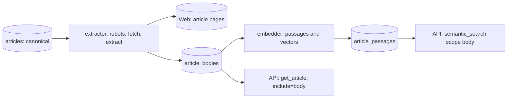

# Spec — body-extraction (M3d)

## 0. Review guide

- GKG has no article body. This milestone fetches the web page behind every canonical article, extracts the text, keeps it 7 days, serves it to agents, and embeds it in passages so an agent can ask for a scope or a kind of news and search the **text**, not only the titles (RAG).
- It reverses the MVP rule "do not scrape article pages" (`CLAUDE.md`, GDELT rules). The owner chose that on 2026-11-02 (D-1 to D-3); `CLAUDE.md` is updated at implement time.
- Review order: §3 data findings → §4 scope → §6 ACs → Decisions and risks below.

Flow of the slice (a new worker beside the embedder; ingestion is untouched):



### Decisions

| ID | Decision | Status |
|---|---|---|
| D-1 | Delivery: a background `extractor` stores cleaned text for 7 days, served by `include=body` / `get_article`; the text is also embedded so agents can search it (RAG) | Decided: background extractor + embed + search (2026-11-02, owner: "on top of option 1, we should extract and embed, when agent ask for a scope or a type of news, we can search in RAG") |
| D-2 | Which articles: every canonical article | Decided: every canonical article (2026-11-02) |
| D-3 | Conduct and storage: honest user agent, obey robots.txt, one request per site at a time with a delay, text capped at 20,000 characters, kept 7 days like articles, served only through the authenticated API | Decided: polite and bounded (2026-11-02) |
| D-4 | This reverses the MVP rule "do not scrape article pages" | Decided with D-1 to D-3 (2026-11-02); `CLAUDE.md` changes at implement |
| D-5 | How the text search is exposed to agents | Decided: `semantic_search` gets `scope` = `titles` \| `body` \| `all` (2026-11-02); owner asked to use the content embeddings for a more accurate search, so `all` fuses title and passage results; default stays `titles` until measured |
| D-6 | What the extractor does when it cannot keep up with the feed | Decided: newest first, never fetch anything older than the 7-day window (2026-11-02) |

**D-5.** Decided, with the owner's question "can we use the content embedding for more accurate search?" answered yes: `semantic_search` takes `scope`. `titles` is today's behaviour. `body` searches the passage vectors (and the keyword text of the passages) and returns each article with its best matching passage. `all` fuses the title legs and the passage legs by reciprocal rank, so an article is found by its headline or by its text, and articles with no stored body (about a third) are still found through the title. The default stays `titles` so current callers see no change; a setting (`api.semantic_default_scope`) switches the default to `all` once an evaluation shows it is better. What would change it: you want `all` as the default from the first day.

**D-6.** Decided: newest first, and an article older than the retention window is never fetched. Fresh news matters most and an outage must not leave a growing backlog.

Open risks:
- **Storage.** Measured in T-01 (100,000 synthetic passages of 1,000 characters, `halfvec(768)`): 4.9 KB per passage including the text, the HNSW index (2.0 KB), the full-text index (0.26 KB) and the primary key; the same table with `vector(768)` is 9.4 KB. With the measured mean of 4.7 passages per usable article, 70% usable articles and 50–75 k articles a day, 7 days is about 1.15–1.7 M passages: **about 6–8.5 GB** for the passages table with `halfvec` (11–16 GB with `vector`) **[verified rates, assumed article volume]**.
- **Bandwidth.** Measured in T-01 on 320 article-weighted URLs: pages are 156 KB decoded at the median and 33 KB on the wire (mean 45 KB), so 50–75 k attempts a day is about 2–3 GB a day on the wire (6–9 GB decoded) **[verified rates, assumed article volume]**.
- **Legal.** Storing and serving third-party article text is a copyright and terms-of-service question, and GDELT's own terms are still unchecked. D-3 limits it; it is not a legal opinion. The data must not be served publicly.
- **Reach.** About a third of sampled sites cannot be used (robots, HTTP 451/403), and JavaScript-only or paywalled pages give little text. Coverage will be well below 100%.
- **Fixtures.** Real article HTML is third-party content; tests use synthetic or heavily trimmed pages, never a stored copy of a real article.

Prerequisites the owner owns: disk and bandwidth for the numbers above; Ollama running with `nomic-embed-text` (already used by the embedder); the call on whether the stored text may be kept at all (D-3 says yes, 7 days, private).

## 1. Problem

An agent that wants to know what an article says, or to find news by topic, has only the title and GDELT's themes and tone. Title search (M3a) finds headlines, not stories. The text is public on the web, but each agent fetching it itself would multiply the load on publishers and repeat the cleaning work.

## 2. Goals

| Goal | Measured by |
|---|---|
| G-1 Text of canonical articles is fetched, cleaned and stored, politely and safely | AC-1…AC-8 |
| G-2 Agents can read the text of an article | AC-9, AC-10 |
| G-3 Agents can search by meaning across the text and get the matching passage, alone or fused with the titles | AC-11…AC-14 |
| G-4 The rest of the platform is not harmed | AC-15 |
| Learning | Polite crawling (robots, rate limits, SSRF), content extraction and its failure modes, chunking and retrieval quality for RAG |

## 3. Data/reality (checked 2026-11-02)

- **[verified]** Extraction library: `trafilatura` 2.3.1, released 2026-10-06, Python ≥ 3.10. Alternatives alive on PyPI: `newspaper4k` 0.9.6.1 (2026-11-01), `goose3` 3.1.22 (2026-07-23), `readability-lxml` 0.9 (2026-08-27), `justext` 3.0.2 (2025-02-25).
- **[verified] Fetch sample.** 40 canonical GKG URLs from slot `20261102110000`, one per site, fetched once each with an honest user agent, robots.txt respected, 15 s timeout, 2 MB cap:
  - robots.txt disallowed our agent on 9 sites (22%); none unreachable.
  - Of the 31 allowed: 28 returned HTTP 200 (90%), 2 returned HTTP 451 (unavailable for legal reasons), 1 returned 403.
  - Of the 28 pages, `trafilatura` produced at least 500 characters for 26 (93%) and a short text for 2. Median 3,621 characters, maximum 10,388.
  - Fetch time: median 0.3 s, maximum 3.4 s. Page size: 13 KB–927 KB, median about 181 KB (decoded).
  - So about 65% of the sampled sites gave usable text (26 of 40). The sample is **one URL per site**, not weighted by article count: GKG slots are dominated by a few sites (`docs/research.md`: three sites carry 62 of 527 rows), so the article-weighted share may differ. The design spike must repeat this on a larger, article-weighted sample.
- **[verified, T-01 2026-11-02] Article-weighted sample.** 320 URLs drawn at random from 4,218 distinct URLs of 5 real slots (231 sites, at most 5 per site), fetched with the designed rules (Protego robots, honest agent, at least 5 s between requests to one site, only public addresses, pinned address, no stored content): **69.7% ended `ok`**, 14.4% `blocked_robots`, 13.1% `http_error` (403: 22, 451: 11, **429: 8**, one redirect without a target), 1.6% robots.txt unreachable, 0.6% `no_text`, 0.6% `failed`. Text median 2,957 characters (p10 1,051, p90 7,631; 2 of 223 hit the 20,000 cap); mean 4.7 passages per usable article (median 4, max 27); fetch median 0.39 s (p90 1.19 s); extraction 17 ms median (p95 55 ms); the whole sample took 35 s. The 40-site, one-URL-per-site figure (65%) was close.
- **[verified, T-01] Pinned-address TLS.** With `httpx` 0.28.1 / `httpcore` 1.0.9 a request to a validated IP with `Host` and `extensions={"sni_hostname": host}` verifies the certificate against the site's name: against a local TLS server with a throwaway CA a matching certificate passes, a mismatching one fails ("Hostname mismatch"), the extension is required (without it "IP address mismatch"), and against a real HTTPS site the right name passes and a wrong name fails. **Pitfall found:** with a pooled keep-alive connection, a later request to the same IP reuses the already verified connection and the claimed name is not checked again (a request claiming `example.com` returned HTTP 200). The fetcher must therefore never reuse a connection across requests (fresh client per request, or `max_keepalive_connections=0`).
- **[verified, design check]** Python's built-in `urllib.robotparser` ignores wildcard and `$` rules (it allowed 3 of 6 test URLs that `protego` 0.7.0 correctly refuses), so the extractor uses Protego; on the 40-site sample both parsers disallowed the same 9 sites. 5 of the 40 sites declare a `Crawl-delay` for us (1, 1, 10, 20, 20 s), which the extractor must honour.
- **[verified]** Volume: slot `…110000` had 962 GKG rows, 778 stored as canonical articles (the rest are copies of the same story); an earlier slot had 527 rows. At 96 slots a day that is about 50–75 k canonical articles a day **[assumption from two slots]**.
- **[verified]** Embedding speed on this machine (Ollama, `nomic-embed-text`, F16, batch input): 160 passages/s for 100 characters, 67–70/s for 1,000 characters, 23/s for 3,000 and 12/s for 6,000. Ollama reports a served context of **2,048 tokens** for this model, so one vector cannot cover a long article: passages are needed. At about 4 passages of 1,000 characters per article that is 200–300 k passages a day, about 1–1.5 hours of embedding a day at 70/s.
- **[verified]** Platform facts: the embedder app polls Postgres for rows without a vector and embeds through `newsdock_embedding` (ADR-0024); `semantic_search` runs a vector leg (HNSW cosine) and a full-text keyword leg fused by reciprocal rank (ADR-0025); only canonical articles are in `articles`, copies are in `article_sources` (M2a); retention deletes by `ingested_at` with a cascade.
- **[memory]** nomic-embed-text is trained for up to 8,192 tokens but Ollama serves 2,048 unless the context is raised; `halfvec` exists in pgvector ≥ 0.7.
- **Not verified:** GDELT redistribution terms; per-site rate limits and bot blocks over a day of requests; how often pages need JavaScript; whether retrieval over passages beats title search (needs an evaluation set, as `make eval-search` did for titles).

## 4. Scope (walking skeleton)

In:
- A new worker app `extractor` that takes canonical articles without a body, newest first, and for each: checks robots.txt (cached per site), refuses unsafe addresses, fetches with an honest user agent and per-site spacing, extracts the main text, caps it at 20,000 characters and stores it with a status (`ok`, or the reason it failed).
- Table(s) for bodies and passages, retention with the article, migration, roles and grants.
- Passages of each stored body embedded by the existing embedder path (new queue, same model and client).
- API: `body` on `get_article` / `GET /api/articles/{id}` (always, null when none), opt-in `include=body` on the list tools and `GET /api/articles`; `semantic_search` with `scope` `titles` | `body` | `all` (D-5).
- Settings in `infra/config/newsdock.yaml`, compose service and healthcheck, docs and OpenAPI, `CLAUDE.md` rules updated.

Out (deferred; see `backlog.md`):
- Re-fetching or updating a stored body; fetching copies in `article_sources`; non-HTML formats (PDF); JavaScript rendering; paywall or login handling; images; language detection and translation.
- Web UI screens; the digest agent using bodies; a retrieval-quality evaluation set beyond a small smoke check; summarising with an LLM.

## 5. Users and key flows

- **Agent (MCP/REST client):** reads the text of an article (`get_article`, `include=body`) and asks for news by meaning over the text: "central bank hints at rate cut" returns articles with the passage that matched.
- **Operator:** runs the stack; the extractor keeps pace or falls behind without breaking anything else; sites that refuse us are skipped and counted.

## 6. Acceptance criteria

```
AC-1  robots.txt is obeyed
  Given a site whose robots.txt disallows our user agent for an article path
  When  the extractor processes that article
  Then  the page is not requested, the body row has status `blocked_robots` and no text
  Verify: auto

AC-2  Polite fetching
  Given three articles on one site and one on another, and a configured per-site delay
  When  the extractor runs
  Then  every request carries the descriptive user agent, the requests to the first site are made one at a time at least the delay apart, and the other site is not held up by them
  Verify: auto

AC-3  Unsafe addresses are refused
  Given article URLs that resolve to a loopback, private, link-local or metadata address, use a scheme other than http or https, or redirect to such an address
  When  the extractor processes them
  Then  nothing is requested from those addresses and each body row has status `blocked_address`
  Verify: auto

AC-4  Text is extracted and capped
  Given an HTML article page (synthetic, shaped like a news page) with navigation, ads and a long main text
  When  the extractor processes it
  Then  the stored text contains the main text and none of the navigation, is at most 20,000 characters, and the status is `ok`
  Verify: auto

AC-5  Failures are recorded, not retried forever
  Given pages answering 403, 404, 429, 451, 500, a timeout, a non-HTML content type, an oversize body and a page with no extractable text
  When  the extractor processes them
  Then  each gets a distinct status and no text; 4xx (except 429) and non-HTML are final, 429, 5xx and timeouts are retried a bounded number of times and then final
  Verify: auto

AC-6  One body per article, no refetch
  Given an article that already has a body row
  When  the extractor runs again, or a message is delivered twice
  Then  the page is not requested again and no second row exists
  Verify: auto

AC-7  Newest first, nothing older than retention
  Given a backlog of articles with different ingestion times, some older than the retention window
  When  the extractor picks work
  Then  newer articles are taken before older ones and articles older than the retention window are never fetched
  Verify: auto

AC-8  Retention removes text and passages
  Given bodies and passages for articles older and newer than the retention window
  When  the article retention job runs
  Then  the older articles' bodies and passages are gone with them and the newer ones remain
  Verify: auto

AC-9  The text of one article
  Given an article with a stored body
  When  an agent calls `get_article` (MCP) or `GET /api/articles/{id}` (REST)
  Then  the response has `body` (the text) and `body_status` `ok`; for an article with no body the text is null and the status says why, `pending`, or `none` when the article has no body row at all (it predates the feature)
  Verify: auto

AC-10  Opt-in text in lists
  Given articles with and without a stored body
  When  a list or search tool or `GET /api/articles` is called with `include=body`, and again without it
  Then  with it each article carries `body` (null when none), without it the response is identical to before this milestone
  Verify: auto

AC-11  Passages are embedded
  Given a stored body and a configured embedding model
  When  the embedder runs
  Then  the body is split into passages, each passage gets a vector from the configured model, passages of another model are re-embedded, and a body is not split twice
  Verify: auto
  (Changed 2026-11-04, ADR-0036 amendment: the passage pass runs only with `embedder.embed_passages: true`; the default is off until the backlog's retrieval evaluation shows passage vectors beat the keyword leg. The AC's tests drive the pass directly and still hold.)

AC-12  Search over the text
  Given articles whose bodies are embedded and a query phrased differently from the words in the text
  When  an agent calls `semantic_search` with `scope` `body` in `vector` or `hybrid` mode, with or without the usual filters
  Then  the matching articles are returned, each with its best passage and a score, and the time, theme, domain and `min_negativity` filters apply
  Verify: auto

AC-13  Titles and text fused
  Given one article that matches a query only through its title, one only through a passage, and one without a stored body
  When  an agent calls `semantic_search` with `scope` `all`, and again with `scope` `titles` or none
  Then  `all` returns all three, each with the legs that matched it (`matched_by`) and the passage when one matched; `titles` (the default) returns exactly what it returned before this milestone
  Verify: auto

AC-14  Text search degrades like title search
  Given the embedding service is down
  When  the text search is called with `scope` `body` or `all`
  Then  `vector` mode fails with `embedding_unavailable` and `hybrid` returns the keyword results with `degraded` true
  Verify: auto

AC-15  The rest of the platform is unaffected
  Given the extractor and the embedder's body queue are stopped or failing
  When  GDELT slots are ingested and an agent searches titles and reads articles
  Then  ingestion, the sink, title search and `get_article` work as before, and the API makes no outbound request to article sites
  Verify: auto

AC-16  One live slot end to end
  Given the stack running with the new images and a real slot ingested
  When  the extractor and embedder have worked through part of it
  Then  `article_bodies` holds rows by status, `get_article` of an `ok` article returns text, and a text search (`scope` `body` and `all`) returns a matching passage; the owner records the counts by status
  Verify: manual
```

Provisional targets, measure first (not requirements): the share of canonical articles that end `ok` (about 70% in the 320-URL article-weighted sample, 65% in the 40-site sample), the minimum text length that counts as usable (500 characters in the spike), the per-site delay, fetch concurrency, timeouts and the size cap (15 s and 2 MB in the spike), retry count and backoff, passage size and overlap (about 1,000 characters), passages per article, backlog size and fetch rate per day, bytes per passage with its index, and retrieval quality against title search.

## 7. Non-functional requirements

- Safe by construction: no request to private or loopback addresses (SSRF), bounded response size, time and redirects, no cookies or credentials sent, text stored and served as plain text and escaped by any UI.
- Polite: obey robots.txt, identify honestly, never hammer one site.
- Idempotent and at-least-once like every worker; SQL parameterised; settings per ADR-0013; Postgres roles with least privilege (a new `extractor_rw`).
- Independent: the extractor and the body embedding can fail or lag without touching ingestion, the sink or title search.

## 8. Assumptions

- **[assumption]** A separate app `extractor` (own container) rather than code in the embedder or API: it is the only component that talks to the open web.
- **[assumption]** Passages are embedded by the existing embedder application as a second queue; the design decides.
- **[assumption]** English-language bias of the embedding model is accepted (as for titles).
- **[assumption]** The 7-day window and `retention_days` of articles also govern bodies and passages.

## Glossary

- **Canonical article:** the one row in `articles` per story; later copies of the same story are only in `article_sources`.
- **Body:** the cleaned main text of an article page, at most 20,000 characters.
- **Extraction:** pulling the main text out of an HTML page and dropping navigation, ads and boilerplate (`trafilatura`).
- **Passage:** a piece of a body of about 1,000 characters that gets its own vector.
- **RAG (retrieval-augmented generation):** searching stored text by meaning so an agent can read the best passages before answering.
- **robots.txt:** a site's file saying which paths automated clients may fetch.
- **SSRF:** server-side request forgery, tricking a server into requesting internal addresses; guarded by refusing loopback, private and link-local targets.
- **Crawl-delay:** a robots.txt line asking clients to wait that many seconds between requests; 5 of 40 sampled sites declare one for us (1 to 20 s).
- **Protego:** the robots.txt parser used by the extractor (Python's built-in one ignores wildcard and `$` rules).
- **Pinned address:** the fetcher resolves a site's name itself, checks the address is public and connects to exactly that address, so a second DNS answer cannot redirect the request.
- **Discovery pass:** the extractor's step that creates `pending` rows for new articles by following `articles.seq`.
- **HTTP 451:** "unavailable for legal reasons", returned by some sites to visitors from some regions.
- **Body status:** `none` (no row), `pending`, `ok`, or why there is no text (`blocked_robots`, `blocked_address`, `http_error`, `not_html`, `too_large`, `no_text`, `failed`); exact names are fixed in the design.
