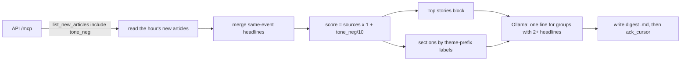

# digest-top-stories — Spec (M2h: a story-first digest, "what people worry about")

Status: init approved 2026-11-02 · design approved 2026-11-02 (ADR-0031 Accepted) · plan approved 2026-11-02 (9 tasks, 20 tests) · implementation not started

## 0. Review guide

**In three lines:** the `whathappen` digest groups articles by GDELT theme code, and real output showed those groups mix unrelated stories ("EDUCATION" held an assault, a restaurant row and an industry award). This spec replaces the theme digest with a **story-first** one: headlines about the same event are merged, each story is scored by how many outlets carry it and how negative it is (`sources × (1 + tone_neg/10)`), the top few go in a **Top stories** block, and the rest sit under fixed plain-language sections (Conflict, Politics, Business, …). The old theme counting, baseline and their data are removed.



**Review order:** §0 decisions → §4 scope → §5 the digest sample → §6 ACs → risks.

### Decisions

| ID | Decision | Status |
|---|---|---|
| D-1 | Digest shape | Decided: **story-first replaces the theme digest** (user choice 2026-11-02, recommended): a Top stories block, then sections of story groups. Themes stop being headings; theme counting, the rolling baseline and "×N vs usual" go away |
| D-2 | Old code and data | Decided (user, 2026-11-02: "remove and clear the old data"). **[assumption]** on scope: the theme/baseline code, tests, settings and docs are deleted from `agents/whathappen`; the files the old version wrote (`output/YYYY-MM-DD/*.md`, `latest.md`, `baseline.json`) are deleted once by an explicit, listing command (AC-14). The agent's registration, key and server-side cursor on the platform stay |
| D-3 | Ranking | Decided: **score = sources × (1 + tone_neg / 10)** (user choice 2026-11-02, recommended). **[assumption]** details: a group's `sources` is the sum of its articles' `source_count`; its `tone_neg` is the largest among its articles (missing counts as 0) |
| D-4 | Merging headlines about one event | Decided: **lexical title match in the agent** (user choice 2026-11-02, recommended): pure Python, no model, no embeddings, behind a swappable port so the platform's clustering can replace it later. **[assumption]** how: shared significant words within a time window; numbers are provisional targets (§7) |
| D-5 | Sections | Decided: **fixed plain labels from GDELT theme prefixes** (user choice 2026-11-02, recommended), a configurable map; a group takes the label with the most theme hits across its articles (design 2026-11-02, replaces "first matching label"); a group with no match goes to "Other". Region is not a heading (74% of domains carry no country hint, §3) |
| D-6 | Which articles each digest ranks | Decided: **keep the hourly new-articles window** with `list_new_articles` and `ack_cursor` (user choice 2026-11-02; a rolling last-24h read via `search_articles` was recommended instead, see risk 1) |
| D-7 | Where tone comes from | Decided **[assumption]**: the agent calls `list_new_articles` with `include=["tone_neg"]` (platform M3b `tone-in-summary`). If the platform does not return it, scoring uses coverage alone and the file says so |
| D-8 | How much is listed | Decided **[assumption]**: a Top stories block of the best 5 groups, then at most 6 sections of at most 4 groups each; a group with fewer than 2 sources is not listed; all provisional (§7) |
| D-9 | Where the model is used | Decided **[assumption]**: one Ollama sentence only for a group with 2 or more distinct headlines, built from those headlines alone; a single-headline group shows its headline. Failure degrades only that line (as in M2g) |
| D-10 | Unchanged from M2g | Decided **[assumption]**: hourly loop, `make once`, own key and cursor, atomic `YYYY-MM-DD/HHMM.md` + `latest.md`, file → ack order, quiet-window behaviour, escaping, Docker packaging, headlines-only notice |

| D-11 | Ranking signal and title cleaning (after the T-01 spike) | Decided (user choice 2026-11-02, recommended): keep the approved score (copies and tone, D-3) and add two cheap fixes: strip a trailing " \| outlet" segment from titles before grouping and display, and a `section_min_hits` setting (default 1). The spike showed coverage mostly measures syndication reach (see [spike.md](spike.md)); the proper fix is a platform `domain_count` field (backlog) |

No open decisions.

### Open risks
1. **Late-growing stories rank low (consequence of D-6).** An article's `source_count` keeps growing for hours after it first appears, but the hourly view reads it within the hour it arrives. A story that later reaches 91 sources may be seen with a handful, and the Top block changes almost entirely each hour. Mitigation: the digest says it covers "new this hour"; a rolling window is the first backlog item and needs no platform change.
2. **Lexical merging is crude.** It misses paraphrases and may join different events that share names. Mitigation: a time window, a conservative threshold, a fixture of real pairs, and the port for a later replacement.
3. **Coverage measures syndication reach, and tone is a blunt signal.** Radio-station networks and local-newspaper chains republish one headline on dozens of sites, each counted as a source, so 1 to 2 of 5 Top slots in the spike hours were soft items; among widely covered stories negative tone is mild (§3), so it barely changes the order. Accepted (D-11); the fix belongs in the platform (`domain_count`, backlog).
4. **Thin hours.** Only about 8% of articles have 2 or more sources, so a quiet hour may list few stories (AC-8 covers the empty case).
5. **Small models invent.** The sentence is written from headlines only and the file says so; it stays a finding about the model, not a failure of this spec.
6. **Platform dependency for tone.** The running dev API predates `tone-in-summary`; until its image is rebuilt the digest ranks by coverage alone (AC-2).

Prerequisites the user owns: the agent key and Ollama as before; for tone-based ranking, a platform API rebuilt from the `tone-in-summary` code; confirming the one-time deletion of old output (AC-14).

## 1. Problem

The first digest (M2g) proved the pipeline but not its usefulness. Its sections are GDELT theme codes, which loosely tag articles, so a section holds unrelated stories under an authoritative heading, and the one-line summary written over them is vague or wrong. The real stories (a senator's stroke, the Alaska Senate dispute, a jet crash) were scattered across the wrong sections, each as one of three links, with no sense of which was biggest. A reader who wants the world in a couple of minutes could not tell what mattered. The same event also arrives as several rows (two headlines about one senator's stroke, 51 and 61 sources), so even a ranked list would repeat it.

## 2. Goals and how they are measured

| Goal | Measure |
|---|---|
| The biggest stories come first, by how widely they are carried and how negative they are | AC-1, AC-6 |
| One event is one entry | AC-3, AC-4, AC-5 |
| Sections a reader recognises, nothing mislabelled as a theme code | AC-7 |
| The digest stays quick to scan and honest | AC-8, AC-9, AC-10, AC-11 |
| Works with or without the new tone fields | AC-2 |
| No leftovers of the theme digest | AC-13, AC-14 |
| It reads well on a real hour | AC-15 (manual) |
| Learning goal | a deterministic ranking and grouping pipeline where the model only writes prose, with the grouping behind a port that platform clustering can replace later |

## 3. Data / reality

Measured on the dev database on 2026-11-02 (articles published in the previous 24 hours, 7 886 canonical rows) unless noted.

- Coverage is a usable importance signal at the top: 7 281 articles have 1 source, **605 have 2 or more, 172 have 5 or more**, the largest has 91 **[verified]**. The top by `source_count` are real news (immigration rules overhaul, a senator hospitalised with a stroke, Senate-race stories, a jet crash) **[verified]**.
- The same event appears as separate rows: "Connecticut Senator Chris Murphy is hospitalized with a stroke" (61 sources) and "Senator Chris Murphy Hospitalized After Stroke" (51); "Stevens Endorses Rogers In Michigan Senate Race" (56) and "Haley Stevens endorses GOP candidate in Michigan Senate race, spurning Abdul El-Sayed" (55) **[verified]**. The platform's story key merges identical titles only, so a reworded duplicate needs another step.
- Tone among widely covered stories is mild: for the 172 stories with 5 or more sources `tone_neg` has median 3.6, 90th percentile 7.0, and only 5 reach 8 **[verified]**. Stories with 3 or more sources and `tone_neg ≥ 10` were three that day (a shooting, a German protest crackdown, a local court case) **[verified]**. So tone is a modest multiplier, not a filter.
- Wire and press-release domains are about 0.9% of articles (70 of 7 886, by a domain pattern) **[verified]**, so a domain blocklist is a small effect; single-source items are kept out of the listing by the minimum-coverage rule instead.
- 74% of domains have no country code (5 797 of 7 886 are `.com`, `.org`, `.net` and similar) **[verified]**; the rest are mostly `.uk`, `.au`, `.in`, `.nz`. A TLD cannot name a region for most stories.
- The platform stores `tone_neg` for 177 693 of 177 707 rows and, since `tone-in-summary`, can return it through `include` **[verified]**; the running dev API image predates that change **[verified]**.
- The previous digest (M2g) read about 2 000 to 2 600 articles per hourly window in 10 to 13 pages, in well under 10 seconds including the model calls **[verified]**, see `docs/specs/what-happen/verify.md`.
- Old generated data sits in the owner's checkout: `agents/whathappen/output/` has one dated folder, `latest.md` and `baseline.json` **[verified]**; it is git-ignored.

## 4. Scope of the milestone (walking skeleton)

The thinnest slice that turns one hour of real articles into a story-first file, end to end.

**In**
- Reading the hour's new articles with `include=["tone_neg"]` (cursor paging, unchanged).
- A merge step (lexical title match) behind a `StoryGrouper` port, with a time window.
- Scoring `sources × (1 + tone_neg/10)`, with a coverage-only fallback.
- The Top stories block and the labelled sections (config map of theme prefixes to labels, "Other").
- One model sentence for groups with 2 or more headlines; the existing prompt rules and failure handling.
- The new renderer and file layout (headlines-only notice kept); atomic writes, ack after the file.
- Removal of the theme counting, baseline, their settings, tests and docs; a one-time listing cleanup command for the old output files.
- Updating the agent README, the what-happen docs that describe the theme digest (marked superseded), and CLAUDE.md.

**Out**
- Embeddings, platform clustering and any new MCP tool (backlog).
- A rolling 24-hour read, stories carried over between hours (backlog, risk 1).
- A noise blocklist for wire domains (backlog; measured effect is small).
- Region headings, a model-chosen section label, a digest web page, readable theme names, a daily roll-up.
- Any change to the platform.

## 5. The digest (what the file looks like)

Illustrative layout, using real headlines from §3; the sentences under them are examples of what the model is asked to write, not measured output.

```markdown
# What happened · 2026-11-02 14:07 UTC (1 920 new articles · 41 stories)

> New this hour, from headlines only. Ranked by outlets covering a story and negative tone.
> Summaries are written by a small local model and can be wrong; open the links.

## Top stories
1. [Connecticut Senator Chris Murphy is hospitalized with a stroke](https://example.com/a) · 112 sources
   Senator Chris Murphy was hospitalised after a stroke.
   Also: [Senator Chris Murphy Hospitalized After Stroke](https://example.com/b)
2. [9 dead as jet nosedives and erupts into fireball near busy roadway in South Florida](https://example.com/c) · 35 sources
3. …

## Politics
- [Judge tosses Trump's attempt to block Alaska Senate results if GOP incumbent loses](https://example.com/d) · 51 sources
…

## Conflict & Security
## Business & Markets
## Other
```

Rules: a story appears once in the whole file (in Top stories, or in one section); the shown headline is the one with the most sources (ties: newest) and other headlines of the group are listed as "Also"; a story line carries its domain only when useful and its source total; sections are ordered by their best story's score and empty ones are omitted; the model line appears only for groups with 2 or more distinct headlines.

## 6. Users and key flows

User: the owner of the dev stack, reading `latest.md` or the dated files.

1. `make up` runs the digest service (or `make once` for one cycle); each hour a cycle reads the new articles, merges, scores, writes the file, acks.
2. The owner opens `agents/whathappen/output/latest.md`, reads the Top stories block, then the sections that interest them, and clicks through.
3. Once, after upgrading, the owner runs the cleanup command to remove the old theme digests and baseline.

## 7. Acceptance criteria

```
AC-1  Score ranks coverage and tone
  Given three story groups with (sources, tone_neg) of (50, 2.0), (35, 6.7) and (60, 0.2)
  When  they are scored with sources x (1 + tone_neg / 10)
  Then  the scores are 60.0, 58.45 and 61.2, and the order is (60, 0.2), (50, 2.0), (35, 6.7)
  Verify: auto

AC-2  No tone means coverage only
  Given articles whose tone_neg is absent or null
  When  the groups are scored
  Then  each score equals its source total, and the digest's ranking note says it was ranked by coverage only
  Verify: auto

AC-3  Reworded headlines about one event become one group
  Given the real pair "Connecticut Senator Chris Murphy is hospitalized with a stroke" and "Senator Chris Murphy Hospitalized After Stroke", published within the time window
  When  the grouper runs
  Then  they form one group whose source total is the sum of both, shown headline is the one with more sources, and the other appears as "Also"
  Verify: auto

AC-4  Different events stay apart
  Given headlines that share only common words or one name, such as "Senator Chris Murphy Hospitalized After Stroke" and "Sullivan Accuses Peltola Of Voter Confusion Tactics", and two unrelated "…announces…" headlines
  When  the grouper runs
  Then  every one of them is its own group
  Verify: auto

AC-5  Near-identical headlines far apart in time are not merged
  Given two headlines that match as one event but were published more than the time window apart
  When  the grouper runs
  Then  they stay two groups
  Verify: auto

AC-6  Top stories block
  Given more than five scored groups
  When  the digest is rendered
  Then  the Top stories block holds exactly the five highest scores in descending order, each line a link with its source total, and none of those five appears again in a section
  Verify: auto

AC-7  Sections use fixed labels
  Given groups whose articles' themes match the configured prefixes of "Politics & Government" and "Conflict & Security" (one group with hits for both, the second label having more), and one group with no match
  When  the digest is rendered
  Then  each group sits under the label with the most theme hits across its articles (ties: the label listed first), the unmatched group under "Other", sections are ordered by their best score, and an empty section is not shown
  Verify: auto

AC-8  Single-source stories are not listed
  Given an hour where every group has one source, and another hour with some groups of two or more
  When  the digest is rendered
  Then  the first hour's file is still written (and acked) with a note that no story was widely covered, and in the second only groups with at least the minimum sources appear
  Verify: auto

AC-9  The model is asked only about multi-headline groups
  Given one single-headline group and one group with three distinct headlines
  When  the digest is built
  Then  the summariser is called once, with only the three titles, and the single-headline group shows its headline with no model line
  Verify: auto

AC-10  A failed model call degrades one line
  Given the summariser fails for one group
  When  the digest is built
  Then  that group shows its links and no model line, the file is written and the cursor acked
  Verify: auto

AC-11  Hostile text is escaped
  Given a headline, domain and URL containing markdown, HTML and control characters, in the Top block and in a section
  When  the digest is rendered and the output is read by a markdown link reader
  Then  each is a single well-formed link or plain text, with nothing interpreted as markup
  Verify: auto

AC-12  File first, then ack
  Given a cycle that reads a window ending at cursor C
  When  the digest file is written successfully
  Then  ack_cursor was called once with C, after the file was fully written, and not at all when the write fails
  Verify: auto

AC-13  The theme digest is gone
  Given the agent's source, settings, tests and documents
  When  they are searched and the settings class is inspected
  Then  there is no theme counting, rolling baseline, "vs usual" text, baseline file or settings for them, and an old environment still containing the removed variable names starts without error
  Verify: auto

AC-14  Old output is removed once, on request
  Given an output folder holding old-format files (dated digests, latest.md, baseline.json) and new-format files
  When  the cleanup command runs with a dry-run flag, then for real
  Then  the dry run lists exactly the old-format files and deletes nothing, and the real run deletes only those
  Verify: auto

AC-15  A real hour reads well
  Given the dev platform (with tone available) and Ollama running
  When  make once is run on a real window
  Then  latest.md shows a Top stories block of real headlines with working links, the same event does not appear twice in it, sections carry plain labels, and the owner confirms it is clearer than the theme digest
  Verify: manual
```

Provisional targets — measure first, not requirements: lexical match threshold and time window (starting guess: 48 hours, as the platform's story window), Top block size (5), sections (6) and groups per section (4), minimum sources to list (2), the label set and its theme-prefix map (Conflict & Security, Politics, Business & Markets, Crime & Courts, Health, Disasters & Accidents, Other), `also` headlines shown per group (3), model timeout.

## 8. Non-functional requirements

- Deterministic ranking and grouping: the same window gives the same file apart from model sentences.
- A cycle stays well inside the hourly budget (the old digest took about 6 s; the new one adds a grouping pass over about 2 000 titles, measured in verify).
- The model never blocks the pipeline; secrets stay in `.env`; no new dependency on the platform's code (the agent stays independent, ADR-0029).
- Unchanged from M2g: atomic writes, file-then-ack, escaping, own key and cursor.

## 9. Assumptions

- The platform returns `tone_neg` through `include` once rebuilt from `tone-in-summary`; an older API ignores the argument and returns no tone **[verified]**: when the tone MCP tests were first run against the unchanged tool, `include` was accepted and ignored and the default keys came back.
- Titles carry enough shared significant words to merge a reworded duplicate; to be checked on real pairs at design **[assumption]**.
- The Ollama model and prompt rules from M2g stay (`qwen3:4b-instruct`) **[assumption]**.

## Appendix: Glossary

- **Story group:** headlines judged to report the same event, merged into one entry.
- **Sources (coverage):** how many outlets carried a story; the platform's `source_count`, summed over a group.
- **tone_neg:** GDELT's share of negative words in an article; larger is more negative.
- **Score:** `sources × (1 + tone_neg / 10)`; the order of the digest.
- **Top stories block:** the highest-scoring groups, shown first.
- **Section:** a fixed label (for example Politics) that holds the other listed groups.
- **Lexical match:** deciding two titles are the same event by the words they share, without a model.
- **Port (`StoryGrouper`):** the small interface the digest uses to group headlines, so another implementation can replace the lexical one.
- **Cursor / ack:** the platform's per-agent reading position and the call that moves it forward.
- **Outlet suffix:** a trailing " | Name" segment on a title (for example " | News Radio 105.5 WERC"), stripped before matching and display.
- **Window:** the articles read in one cycle (those new since the last ack).
- **Old output:** files written by the theme digest: dated digest files, `latest.md` and `baseline.json`.
- **v2 marker:** the first line of every new digest, `<!-- whathappen:story-first -->`; invisible when rendered, it lets the cleanup tell new files from old.
