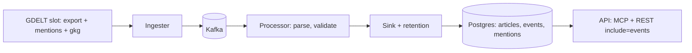

# Spec — events-mentions (M3c)

## 0. Review guide

- GDELT publishes two more files per 15-minute slot next to GKG: **Events** (one row per coded real-world event) and **Mentions** (one row per article that mentions an event). We ingest both, keep 7 days, and let agents read, per article, the events it is about and how many mentions each has.
- Platform only: ingester, processor, sink, API (MCP + REST). No digest-agent change, no web screens.
- Review order: §3 data findings → §4 scope → §6 ACs → Decisions below.

Flow of the slice (the existing GKG chain gets two sibling streams):



### Decisions

| ID | Decision | Status |
|---|---|---|
| D-1 | Cut line: store both streams and serve them per article (MCP + REST, opt-in `include`) | Decided: store + serve per article (2026-11-02) |
| D-2 | Events columns: curated subset, not all 61 | Decided: curated subset (2026-11-02) |
| D-3 | The what-happen digest agent is not changed in this milestone | Decided: platform only (2026-11-02) |
| D-4 | Retention is the same 7 days as articles | Decided: 7 days (2026-11-02), default, not asked |
| D-5 | How event and mention rows relate to `articles` | Decided: join by `url_hash`, no foreign key (2026-11-02) |

**D-5.** Decided: link by `url_hash` with **no foreign key**. An event's `SOURCEURL` and a mention's `MentionIdentifier` are normalised and hashed the same way as an article URL; the API joins on `url_hash`. Why: the three files of a slot are fetched independently and can arrive in any order (the 404 quirk), a mention can reference an event from an earlier slot, and a foreign key would reject rows that only arrive late. What would change it: a need to guarantee no orphan rows, which would push to a foreign key with deferred insertion.

Open risks:
- Mentions are the biggest stream (about 2,500 rows per slot in the sample); the 7-day size is **[assumption]** until measured (§3).
- Events can mention events from earlier slots, so a mention may point to an event we never stored.
- The GKG, export and mentions files of one slot do not become available at the same moment (404 quirk), so the three streams can be out of step.

Prerequisites the user owns: none (public feed). Dev-stack rebuild of `api` and the other images before the new fields go live.

## 1. Problem

GKG tells us which articles exist and their tone, but not what happened or how widely it was covered. An agent that ranks news by importance has to guess from titles. GDELT already codes events (who did what to whom, where, how impactful) and counts the mentions of each; we do not store them.

## 2. Goals

| Goal | Measured by |
|---|---|
| G-1 Events and Mentions of every slot reach Postgres | AC-1…AC-7 on fixtures; AC-14 on one live slot |
| G-2 An agent can read the events and mention count of an article without a second call | AC-9…AC-13 |
| G-3 No harm to the existing pipeline | AC-10, AC-12 (payload unchanged), AC-8 (GKG slot unaffected) |
| Learning | Joining three streams of one source that arrive out of order; idempotent upsert for two new tables; extending a shared contract with an opt-in field a second time (ADR-0030 pattern) |

## 3. Data/reality (checked 2026-11-02)

Real files fetched from `https://data.gdeltproject.org/gdeltv2/` (the index lists `http://` URLs that redirect). Slots `20261102110000` and `20261102120000`.

- **[verified]** `lastupdate.txt` lists `*.export.CSV.zip` (Events), `*.mentions.CSV.zip` (Mentions) and `*.gkg.csv.zip`. The 404 quirk applies to all three files independently: for `20261102121500` the Events and GKG downloads returned an empty body while Mentions returned 200, and for `20261102120000` the GKG download returned 404 while Events and Mentions returned 200, although `masterfilelist.txt` listed all three with sizes.
- **[verified]** Events: tab-separated, **61 columns** in all 996 rows of `…110000` (908 of 908 in `…120000`), no header. Mentions: **16 columns** in all 2,567 rows (2,946 in `…120000`). Zipped size of slot `…110000`: Events 68 KB, Mentions 86 KB, GKG 3.9 MB.
- **[verified]** Column positions (1-based) in a real Events row: 1 `GLOBALEVENTID`, 2 `SQLDATE`, 6 `Actor1Code` … 16 `Actor2Code` family, 26 `IsRootEvent`, 27 `EventCode`, 28 `EventBaseCode`, 29 `EventRootCode`, 30 `QuadClass`, 31 `GoldsteinScale`, 32 `NumMentions`, 33 `NumSources`, 34 `NumArticles`, 35 `AvgTone`, 36… `Actor1Geo_*`, 44… `Actor2Geo_*`, 52… `ActionGeo_*` (type, full name, country, ADM1, ADM2, lat, long, feature id), 60 `DATEADDED`, 61 `SOURCEURL`. Names are from the GDELT 2.0 event codebook **[memory]**; positions were confirmed against one sample row only (its Actor1 columns were empty; Actor2 code/name/country were `USA`/`FLORIDA`/`USA` in columns 16–18); the design must re-check the layout on more rows.
- **[verified]** Mentions: 1 `GLOBALEVENTID`, 2 `EventTimeDate`, 3 `MentionTimeDate`, 4 `MentionType` (1 = web; all 2,567 rows), 5 `MentionSourceName`, 6 `MentionIdentifier` (the URL), 7 sentence id, 8/9/10 char offsets, 11 `InRawText`, 12 `Confidence`, 13 `MentionDocLen`, 14 `MentionDocTone`, 15 translation info, 16 extras.
- **[verified] Join to GKG is exact in this slot:** all 221 distinct Events `SOURCEURL`s and all 427 distinct mention URLs appear in the GKG file of the same slot (962 distinct URLs). The match was on the raw URL string; our own key is the hash of the *normalised* URL, so normalisation must be applied to both sides (checked in the design).
- **[verified]** Fan-out: 996 events point to 221 URLs (about 4.5 events per article); 2,567 mention rows cover 427 URLs (about 6 per article).
- **[verified]** Mentions of events from earlier slots exist: of 1,712 distinct event ids mentioned in `…110000`, only 996 (58%) are in that slot's Events file. The rest were created earlier. Events are mostly new: 981 of 996 have a 2026-11 `SQLDATE`; 15 are older (earlier research found old `SQLDATE`s too).
- **[verified, spec-verify 2026-11-02]** Real volume (7 slots): 735–1,132 events and 1,982–2,946 mentions per slot; one whole slot loaded through the real sink code took 0.5 s for events and mentions together. Measured size on a small slot is 518 B per event and 574 B per mention including indexes (264 B per mention heap only; small tables overstate the index share), so 7 days is about 0.5–0.8 M events and 1.3–2.0 M mentions, roughly 0.35–1.1 GB for mentions and 0.2–0.4 GB for events: above the first guess below. The 7-day size is still to be read from a live stack (`verify.md` F-2).
- **[assumption, superseded by the line above]** Volume: if every slot looks like the sample, about 96 k events and 250 k mentions per day, 0.7 M events and 1.7 M mentions in 7 days. One slot is not a measurement; the design spike must sample more slots.
- **[memory]** GDELT asks for citation; redistribution terms must be checked before any public hosted demo (open item in `docs/research.md`). No scraping is involved.
- **[verified, T-01]** Across six slots: all Events rows 61 columns, all Mentions rows 16, an event's own `SOURCEURL` is among its mentions in 100% of events, event URLs are in the same slot's GKG in 99.4–100% of cases (a few are not), and repeated (event, URL) mention rows run 0–53 per slot. Details in `design-detail.md` §1.
- **Not verified:** how often a mention row arrives before the Events row it points to; GDELT redistribution terms.

## 4. Scope (walking skeleton)

In:
- Ingester fetches the Events and Mentions files of a slot with the existing rules (follow redirects, md5, 404 or empty body means retry later, never below the poll interval) and publishes their rows.
- Processor parses 61/16-column rows into a curated event record and a mention record; bad rows go to the dead-letter topic with a reason.
- Sink upserts into two new tables idempotently; retention deletes rows older than 7 days.
- API: opt-in `include=events` (events of each article with their mention count) on `search_articles`, `semantic_search`, `list_new_articles` and `GET /api/articles`; `get_article` and `GET /api/articles/{id}` always carry them.
- Config in `infra/config/newsdock.yaml`, topic names as settings (ADR-0013), a migration, docs and OpenAPI updated.

Out (deferred; see `backlog.md`):
- Digest agent change (D-3). Web UI screens. Filters on event fields (CAMEO, Goldstein, country). SSE/push on events. Body extraction (own spec).
- Events columns beyond the curated subset (D-2); per-mention detail fields.

## 5. Users and key flows

- **Agent (MCP/REST client):** asks for articles with `include=events` and sees, per article, the events it is mentioned in (found through the mentions table, at most 20, ADR-0033) and each event's coded type, actors, place, impact and mention count.
- **Operator:** runs the stack; the three streams of a slot are ingested without manual steps; a slot with a missing Events or Mentions file does not stop GKG.

Curated Events fields (D-2): event id, date (`SQLDATE`), actor 1 and 2 (code, name, country code, type 1), `IsRootEvent`, CAMEO code, base code, root code, `QuadClass`, Goldstein scale, `NumMentions`, `NumSources`, `NumArticles`, `AvgTone`, action geo (full name, country, ADM1, latitude, longitude), `DATEADDED`, source URL. Mention fields kept: event id, mention URL, source name, mention time, confidence. The exact names and types belong to the design.

## 6. Acceptance criteria

```
AC-1  Parse an Events row
  Given a real 61-column Events row from the fixture file
  When  the processor parses it
  Then  it yields an event record with the id, date, actors, CAMEO codes, Goldstein, mention counts, tone, action geo and normalised source URL hash
  Verify: auto

AC-2  Parse a Mentions row
  Given a real 16-column Mentions row from the fixture file
  When  the processor parses it
  Then  it yields a mention record with the event id, mention URL hash, source name, mention time and confidence
  Verify: auto

AC-3  Bad Events and Mentions rows are dead-lettered
  Given an Events row with 60 columns, one without an event id, and a Mentions row with no URL
  When  the processor handles them
  Then  each goes to the dead-letter topic with a reason (existing reasons reused where they fit, new ones listed in the design) and is not stored
  Verify: auto

AC-4  Independent slot fetch
  Given a slot whose Events file returns 404 and whose GKG and Mentions files return 200
  When  the ingester runs
  Then  GKG and Mentions rows are published, the Events file stays pending for retry (at most 4 attempts) and the GKG slot is not blocked
  Verify: auto

AC-5  Replay creates no duplicates
  Given a slot's Events and Mentions rows already stored
  When  the same rows are consumed again
  Then  the row counts of both tables are unchanged
  Verify: auto

AC-6  Late and updated events
  Given an event already stored with NumMentions = 3
  When  the same event id arrives again in a later slot with NumMentions = 7
  Then  exactly one event row exists and it holds NumMentions = 7
  Verify: auto

AC-7  Out-of-order mentions are kept
  Given a mention whose event id is not yet in the events table
  When  the sink stores it and the event arrives later
  Then  the mention row is stored at once, and after the event arrives both are returned together for the article
  Verify: auto

AC-8  Retention covers both tables
  Given events and mentions older than 7 days and some newer
  When  the retention job runs
  Then  only the older rows of both tables are deleted and the articles retention behaves as before
  Verify: auto

AC-9  Events per article through MCP
  Given an article with two stored events and a mention count for each
  When  an agent calls `get_article`, or a list/search tool with `include=["events"]`
  Then  the article carries `events` with those two events (curated fields and `mention_count`)
  Verify: auto

AC-10  Payload unchanged without include
  Given the same article
  When  a search or list tool is called without `include`, or with `include` of the tone values only
  Then  the response has no `events` key and is identical to the response before this milestone
  Verify: auto

AC-11  Events per article through REST
  Given the same article
  When  a client calls `GET /api/articles/{id}`, or `GET /api/articles?include=events`
  Then  the article carries the same `events`; `GET /api/articles` without `include` does not
  Verify: auto

AC-12  Article with no events
  Given an article for which no event or mention is stored
  When  it is returned with `include=events`
  Then  `events` is an empty list and nothing fails
  Verify: auto

AC-13  Invalid include value
  Given a request with `include` containing an unknown name
  When  the MCP tool or REST endpoint handles it
  Then  MCP answers `invalid_include` and REST answers 422 `invalid_include`
  Verify: auto

AC-14  One live slot end to end
  Given the dev stack running with the new images
  When  one real slot has been ingested
  Then  the events and mentions tables hold rows of that slot, and an article of the slot returns events through `get_article`; the owner records the row counts and the share of events with a matching article
  Verify: manual
```

Provisional targets, measure first (not requirements): rows per slot, table size after 7 days, the share of events whose URL has an article in our store, extra seconds per slot for the two extra files.

## 7. Non-functional requirements

- Idempotent writes and at-least-once consumers, as for every other stream.
- Parameterised SQL only; the new tables need a migration and a least-privilege database role is reused or extended as the design decides.
- The extra ingest work must not delay GKG publication: the three files are independent in state and retry.
- Settings follow ADR-0013 (a new field with a default, plus a visible row in `newsdock.yaml`).

## 8. Assumptions

- **[assumption]** Same pipeline shape (ingester → Kafka → processor → sink) rather than a second path; the design may revisit it.
- **[assumption]** `SOURCEURL` and `MentionIdentifier` normalise with the same function as GKG URLs (`newsdock_core`).
- **[assumption]** Only `MentionType` 1 (web) rows exist in practice; other types, if seen, are stored or dropped as the design decides.
- **[assumption]** English-only filtering is not applied to Events/Mentions (GKG has none either).

## Glossary

- **GDELT Events (export file):** one row per event coded from news (61 columns).
- **GDELT Mentions:** one row per article that mentions an event (16 columns).
- **CAMEO:** the event taxonomy GDELT uses; the root code (01…20) is the broad class, e.g. protest, sanction.
- **Goldstein scale:** −10…+10 score of an event type's theoretical impact on stability.
- **QuadClass:** 1 verbal cooperation, 2 material cooperation, 3 verbal conflict, 4 material conflict.
- **NumMentions / NumSources / NumArticles:** how often, in how many outlets and in how many articles GDELT has seen the event.
- **Slot:** one 15-minute set of GDELT files.
- **404 quirk:** a listed file that is not yet downloadable; retry later.
- **`url_hash`:** sha256 of the normalised URL, the public article id.
- **Dead-letter:** the topic for rows that cannot be parsed.
- **`kind`:** the tag on raw and dead-letter messages saying which GDELT file a line came from (`gkg`, `events`, `mentions`; ADR-0032).
- **`ingest_file`:** the table holding fetch state (pending, published, failed) of the Events and Mentions file of a slot.
