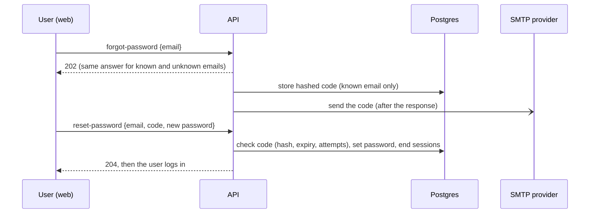

# forgot-password — Spec (M2f: password reset by emailed one-time code)

Status: init · 2026-10-29 · Backlog: [backlog.md](backlog.md)

## 0. Review guide

**Summary:** a user who cannot log in enters their email on the web app, receives a short one-time code by email from a free provider, then enters the code and a new password. The provider is plain SMTP (settings, Brevo documented), the code is stored hashed, single-use, short-lived and attempt-limited, and the answer never reveals whether an account exists. Until SMTP is configured the feature is off.

**Review order:** §0 decisions and risks → §4 scope → §6 acceptance criteria. The rest is reference.



| ID | Decision | Status |
|---|---|---|
| D-1 | Mail goes through plain SMTP (host, port, user, from-address are settings; the password is a secret in the environment). Brevo's free plan is the documented setup; Gmail, Resend SMTP and others work by changing the settings | Decided: any SMTP, Brevo documented (user, 2026-10-29) |
| D-2 | First version includes the API and the web screens (a "Forgot password?" link, an email screen, a code-and-new-password screen) | Decided: API + web screens (user, 2026-10-29) |
| D-3 | The one-time code is a numeric code typed into the web app, not a link in the mail | Decided: code (the user asked for an OTP) (2026-10-29) |
| D-4 | No account enumeration: requesting a code answers the same for known and unknown emails, and a failed reset gives one uniform error | Decided: default (2026-10-29) |
| D-5 | The feature is off until SMTP is configured (routes answer 503, the web hides the link); there is no "print the code in the log" mode | Decided: default (2026-10-29) |
| D-6 | A successful reset ends all of the user's sessions and does not log them in; they log in with the new password | Decided: default (2026-10-29) |
| D-7 | A code is random (CSPRNG), stored only as a hash, valid once, for a short time, with a capped number of wrong attempts; a newer request replaces the older code. The numbers are provisional config values (§6) | Decided: default (2026-10-29) |
| D-8 | The mail is sent after the HTTP response, so the response time does not depend on whether an account exists or how slow the provider is | Decided: default (2026-10-29) |

D-3 to D-8 are conventional defaults recorded for review, not answered one by one; say so if you want any changed before `/spec-design`.

**Risks:**
1. **Unverified email addresses.** Sign-up does not verify the address (ui-login non-goal), so someone can register `victim@example.com` first. Resetting by email then hands that account to whoever controls the mailbox, which is the victim: acceptable, but the account's first password came from the squatter. Email verification stays in the backlog.
2. **Mailbox compromise equals account takeover**, including the `owner` role. The operator path `make user-reset-password` stays as the recovery of last resort and is unchanged.
3. **Mail abuse.** The endpoint makes the server send mail to arbitrary addresses, so it needs per-address and per-client limits (AC-11, AC-12). The existing limiters are in memory and per worker; limits on codes themselves are stored in the database.
4. **Deliverability.** Free providers with a single verified sender can land in spam, and Brevo's free plan caps at 300 mails a day **[verified: Brevo]**. This is a learning/small-scale feature, not a mail platform.
5. **Stacked branch.** This work sits on the `semantic-search` branch (`worktree-p2-delivery`, migrations up to 0009), so its migration will be 0010; merge that branch first.

**Prerequisites the user owns:** a free Brevo account (or another SMTP provider), a verified sender address, and an SMTP key; they go in `.env` (`NEWSDOCK_SMTP_PASSWORD`, never in the repo). Automated tests never send real mail; one optional live send is a manual check (AC-1 note).

## 1. Problem

A user who forgets their password has no way back in: the only recovery is the operator running `make user-reset-password` with the admin token (ui-login D-9). `ui-login` deferred "password reset by email" because no email provider was available; the free providers below remove that blocker.

## 2. Goals and measures

| Goal | Measure |
|---|---|
| A locked-out user can set a new password themselves | AC-3, AC-15, AC-16 |
| The flow cannot be used to find out who has an account or to take one over | AC-3 (unknown email), AC-5, AC-6, AC-10, AC-11 |
| The provider is a setting, not code | AC-1 and AC-2 pass against a local SMTP server; the same settings point at Brevo |
| Learning: one-time codes, hashing short secrets, rate limits with two keys, sending mail without blocking a request | the pieces above exist and are tested |

## 3. Data and reality

- **Existing building blocks [verified: code read this session]:** `store.find_by_email`, `store.set_password_hash`, `store.delete_user_sessions`, the argon2id `PasswordHasher`, `normalize_email`, `check_password` (minimum length setting), the in-memory `LoginLimiter` (per email, unknown emails counted) and `SignupLimiter` (per address and in total), and `POST /api/admin/users/reset-password` (token only). Web: `/login` and `/signup` in `features/auth`, messages in `features/auth/messages.ts`, API types generated from `openapi.json`.
- **Free providers [verified unless noted]:**
  - Brevo: forever-free plan with SMTP relay and 300 emails a day ([Brevo](https://www.brevo.com/en/free-smtp-server/)). Host `smtp-relay.brevo.com`, port 587 STARTTLS or 465, the Brevo login as user and a generated SMTP key as password, and a single sender address verified by a confirmation mail, no domain needed **[secondary sources only]**.
  - Resend: free plan 3,000 emails a month, 100 a day ([resend.com/pricing](https://resend.com/pricing)); sending to arbitrary recipients needs a verified domain **[memory, the pricing page is silent]**.
  - Mailgun: free 100 a day, but without a card only a sandbox with at most 5 authorized recipients **[third-party guides]**, so unusable for real users.
  - SendGrid: the permanent free plan ended on 27 May 2025 ([Twilio changelog](https://www.twilio.com/en-us/changelog/sendgrid-free-plan)); not an option.
  - Gmail SMTP: an app password needs 2-Step Verification, and Google says app passwords "aren't recommended" ([Google](https://support.google.com/accounts/answer/185833)); `smtp.gmail.com` 587/465 and about 500 mails a day **[secondary sources, conflicting]**.
- **Test tooling:** `aiosmtpd` 1.4.6 is a local SMTP server for tests (PyPI, last release May 2024, so possibly quiet) **[verified: PyPI]**; the design stage decides between it and the standard library.
- **Not available this session:** a provider account. Nothing here has sent a real email.

## 4. Scope (walking skeleton)

**In**
- Table for open reset codes (migration 0010): user, hash of the code, expiry, wrong-attempt count, created time.
- Two API routes: `POST /api/auth/forgot-password` (email → 202) and `POST /api/auth/reset-password` (email, code, new password → 204), both outside the login requirement, with the existing origin and JSON guards.
- A mailer port with an SMTP adapter (STARTTLS or implicit TLS, timeout) and a fake for tests; settings `smtp_*`, `mail_from`, the secret password from the environment only.
- Rate limits: per email and per client address on requests; attempts per code.
- Web: a "Forgot password?" link on the login page (only when the feature is on), an email screen, a code-and-new-password screen, success and error messages.
- README: how to set up Brevo (and the same settings for other providers).

**Out**
- Email verification at sign-up, magic links, MFA, changing the email address, HTML mail templates, translations, a local mail catcher in compose (backlog).
- Sending anything other than the reset code (welcome mails, notifications).
- Any change to the operator path `make user-reset-password`.
- Auto-login after a reset.

## 5. Users and key flows

- **User who forgot the password:** login page → "Forgot password?" → enter email → "If an account exists we sent a code" → mailbox → enter code and a new password → "Password changed" → log in.
- **Operator:** puts the SMTP settings and the secret in `.env`, restarts the API; with no SMTP the feature is off and the operator path still works.

## 6. Acceptance criteria

```
AC-1  Request for a known email answers at once
  Given an account for ada@example.com and a mail sender that takes 5 seconds
  When  POST /api/auth/forgot-password is called with ada@example.com
  Then  the answer is 202 with the generic body and arrives before the mail send finishes
  Verify: auto

AC-2  The mail carries a code, and only its hash is stored
  Given an account for ada@example.com and a fake mail sender
  When  a code is requested and the background send completes
  Then  exactly one message went to ada@example.com with a 6-digit code, the validity in minutes and no link, and the database holds a hash of the code, not the code
  Verify: auto (the SMTP adapter is also exercised once against a local SMTP server)

AC-3  An unknown email is indistinguishable and sends nothing
  Given no account for nobody@example.com
  When  POST /api/auth/forgot-password is called with it
  Then  the status and body equal the answer for a known email, no message is sent and no code row is stored
  Verify: auto

AC-4  The correct code sets the new password
  Given a code just sent to ada@example.com
  When  POST /api/auth/reset-password is called with that email, the code and a valid new password
  Then  the answer is 204, logging in with the new password works and logging in with the old one fails
  Verify: auto

AC-5  A code works once
  Given a code that was already used successfully
  When  reset-password is called again with the same code
  Then  it answers 400 invalid_or_expired_code and the password is unchanged
  Verify: auto

AC-6  Wrong codes get one uniform error and kill the code after the cap
  Given a valid code and an attempt cap of N
  When  N wrong codes are sent, then the correct code
  Then  every answer is 400 invalid_or_expired_code (the same for unknown emails), and the correct code no longer works
  Verify: auto

AC-7  An expired code is refused
  Given a code and a clock advanced past its lifetime
  When  reset-password is called with the correct code
  Then  it answers 400 invalid_or_expired_code
  Verify: auto

AC-8  A newer request replaces the older code
  Given two code requests for ada@example.com
  When  the first code, then the second code, are used
  Then  the first is refused and the second sets the password
  Verify: auto

AC-9  A reset ends every session of the user
  Given ada@example.com logged in on two sessions
  When  a reset succeeds
  Then  both sessions stop working and other users' sessions are untouched
  Verify: auto

AC-10  A weak new password is refused and keeps the code
  Given a valid code and a new password below the minimum length
  When  reset-password is called
  Then  it answers 422 invalid_password and the same code still works with a valid password
  Verify: auto

AC-11  Requests are limited per email
  Given a limit of M requests per email per window
  When  M+1 code requests are made for the same email, known or unknown
  Then  the last is refused with 429 and Retry-After (the same for both kinds), and no extra mail is sent
  Verify: auto

AC-12  Requests are limited per client address
  Given a limit of K requests per client address per window
  When  K+1 requests are made from one address for different emails
  Then  the last is refused with 429 and Retry-After and no extra mail is sent
  Verify: auto

AC-13  Without SMTP the feature is off
  Given no SMTP host configured
  When  forgot-password and reset-password are called
  Then  both answer 503 password_reset_unavailable, nothing is stored and nothing is sent
  Verify: auto

AC-14  A mail failure changes nothing for the user and leaks nothing
  Given a mail sender that fails (refused, timeout)
  When  a code is requested for a known email
  Then  the answer is still the generic 202, the stored code is discarded, the failure is logged, and no log line contains the code or the SMTP password
  Verify: auto

AC-15  The login page offers the link only when the feature is on
  Given the web app with the feature on, and with it off
  When  the login page renders
  Then  "Forgot password?" is present and leads to the email screen in the first case, and absent in the second
  Verify: auto

AC-16  The web flow works end to end
  Given the web app against a mocked API
  When  a user submits their email, then the code and a new password
  Then  they see the generic confirmation after the first step, "Password changed" with a link to log in after the second, and the uniform error text for a wrong or expired code
  Verify: auto
```

Provisional targets (config values with these defaults; measure or reconsider before treating them as requirements): code length 6 digits, lifetime 15 minutes, 5 wrong attempts per code, 3 requests per email per hour, 20 requests per client address per hour, SMTP timeout 10 seconds.

## 7. Non-functional requirements

- **Secrets:** the SMTP password only in the environment (the config loader already rejects secret-looking keys in the file); the code is never logged, never returned by the API, never stored in clear.
- **Randomness and comparison:** codes come from `secrets`; comparison is constant-time.
- **Layering:** the mailer is a port in `domain/`, SMTP and the fake are in `adapters/`; SQL only in adapters; env read only in `config.py`.
- **Transport security:** SMTP authenticates only over STARTTLS or implicit TLS; plain SMTP is allowed only for a local test server.
- **Writes** keep the existing JSON-body and allowed-Origin guards.
- **Docs:** README explains the Brevo setup and says the feature is off without it.

## 8. Assumptions

- **[assumption]** A single Brevo sender address is enough to send to any recipient (secondary sources); if not, the Resend-with-a-domain or Gmail settings are the fallback, with no code change.
- **[assumption]** One API worker, as for the other in-memory limiters; per-code limits do not depend on it.
- **[assumption]** The email address is the only proof of identity needed (no security questions).

## Appendix: glossary

| Term | Meaning |
|---|---|
| OTP | One-time password: here a 6-digit code mailed to the user, valid once and briefly |
| SMTP | The standard protocol for sending mail; providers expose a host, a port, a user and a password or key |
| STARTTLS | Upgrades a plain SMTP connection to TLS before logging in (usually port 587) |
| Account enumeration | Learning whether an email has an account from how the service answers |
| Constant-time compare | Comparing secrets so the time taken does not reveal how much matched |
| CSPRNG | A random generator safe for secrets (`secrets` in Python) |
| Brevo | An email service whose free plan includes an SMTP relay (300 mails a day) |
| Mailer port | The interface the domain uses to send mail, implemented by SMTP or a test fake |
