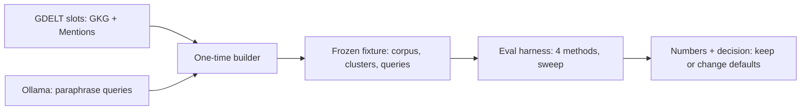

# Spec — harder-search-eval (M3f, follow-up of M3a)

## 0. Review guide

- The search eval (`make eval-search`) scores recall@5 and MRR 1.000 for vector and hybrid on its 40 hand-written titles (semantic-search verify F-5), so it cannot choose the title prefix, `semantic_rrf_k` or `semantic_candidates`, and cannot show whether keyword noise pushes good vector hits out of the hybrid top 5 (F-6).
- This milestone builds a **harder, objective eval**: real titles from several GDELT slots, relevance taken from GDELT's own event ids, queries paraphrased by a local model and frozen. Then it sweeps the three settings on it and changes a default only on a clear win.
- Titles only; body scope stays a live check (decided). No runtime behaviour changes unless a setting wins.
- Review order: §3 reality → §6 ACs → Decisions.

### Decisions

| ID | Decision | Status |
|---|---|---|
| D-1 | Corpus and labels | Decided: real titles from several slots, labelled by GDELT event: two articles are relevant to each other when their URLs mention the same event (2026-11-04) |
| D-2 | Query author | Decided: local LLM paraphrases, frozen into the fixture (2026-11-04) |
| D-3 | What the eval may change | Decided: report, then change a default in `newsdock.yaml` only on a clear win, recorded in an ADR; otherwise keep and document (2026-11-04) |
| D-4 | Body scope | Decided: titles only here; body recall stays a live check (body-extraction F-2), goes to the backlog (2026-11-04) |
| D-5 | Corpus size: several consecutive slots frozen as one fixture | Decided: default, not asked; the number of slots is set by the builder until enough clusters exist (2026-11-04) |
| D-6 | What counts as a "clear win" | Decided: default, not asked; MRR and recall@5 both improve and no kind of query gets worse; the rule is a paired bootstrap over queries: the 95% interval of the MRR difference excludes 0 (set in `/spec-design`, ADR-0039) (2026-11-04) |

**Open risks:** a 1B-parameter paraphraser may write poor or near-copy queries (mitigated by AC-3 and by reading a sample); event labels say "same event", not "same wording", so some relevant articles are not title-similar (that is realistic, and it lowers every method equally); the fixture holds real headlines (attribution is the same as `docs/research.md`).
**Prerequisites the user owns:** Ollama with `nomic-embed-text` and a small chat model (`llama3.2:1b` is pulled) for the builder; network access to GDELT once.

## 1. Problem

The only retrieval measurement saturates, so settings that shape search quality were chosen by default (D-5, D-7 of semantic-search) and nothing can show whether hybrid helps or hurts.

## 2. Goals

- An eval on which keyword, vector and hybrid **differ**. Measured by the real-model run (AC-7).
- A repeatable sweep over prefix on/off × `semantic_rrf_k` × `semantic_candidates`, printed as one table.
- A hybrid noise measure: relevant vector hits that hybrid drops from the top 5.
- Defaults chosen from numbers (or kept, with the numbers recorded).
- Learning: building an objective retrieval benchmark from weak labels; reading recall and MRR honestly.

## 3. Data/reality

- **[verified 2026-11-04]** The slot of 2026-11-02 11:00 (GKG, Events, Mentions) parses with the project's own parsers: 961 articles, 2,567 mentions, 1,712 events with at least one stored article.
- **[verified 2026-11-04]** Only 325 events have 2 or more stored articles in that slot, covering 174 articles, and most are the same syndicated headline; only 83 events have 2 or more different titles (after `story_key`). One slot is therefore too thin: the builder must span several slots (D-5).
- **[verified 2026-11-04]** Ollama is running locally with `nomic-embed-text`; `llama3.2:1b` is the chat model on the machine (CLAUDE.md).
- **[verified in code 2026-11-04]** `apps/api/tests/eval/` already has the harness: `recall_at_k`, `reciprocal_rank`, four methods (`keyword`, `fulltext`, `vector`, `hybrid`), prefix on/off runs, kinds of query; `corpus.json` (40 titles) and `queries.json` (12). Settings: `common.embedding_document_prefix|query_prefix`, `api.semantic_rrf_k` (60), `api.semantic_candidates` (50).
- **[assumption]** Titles of different stories can still be about the same topic (several wildfires, elections), which is the confusability the old set lacked.

## 4. Scope (walking skeleton)

**In:** a one-time builder (GDELT slots + Ollama paraphrases) that writes a frozen fixture; the fixture; the harness reading it, with a settings sweep and the hybrid noise measure; one real-model run; the decision on defaults and its record.
**Out:** body-scope eval, any change to search code, a new MCP tool or route, a UI, running the builder in CI, labelling by hand.

## 5. Users and key flows

The owner (or a future agent) runs `make eval-search` and reads a table: methods × (recall@5, MRR) overall and by kind, a sweep table, and the noise line. A maintainer rebuilds the fixture only when the eval must change.

## 6. Acceptance criteria

AC-1  Fixture is valid
  Given the frozen fixture in `packages/core/tests/fixtures/`
  When  it is loaded
  Then  article ids are unique, every cluster has 2 or more articles with different `story_key`, and the corpus also holds articles outside every cluster (distractors)
  Verify: auto

AC-2  Labels come from events
  Given a small hand-made slot with known mentions
  When  the builder derives clusters
  Then  each cluster is exactly the stored articles that mention one event, and an article of another event is never in it
  Verify: auto

AC-3  Queries are not the titles
  Given the fixture's queries
  When  each is compared with every corpus title
  Then  none equals or contains a title, and each is non-empty
  Verify: auto

AC-4  Queries point at the corpus
  Given the fixture
  When  every query's expected ids are looked up
  Then  all exist in the corpus, are members of the query's cluster, and none is the query's seed (the seed is removed from results and from `expected`, leave-one-out)
  Verify: auto

AC-5  Harness runs on the fixture
  Given the fixture and a fake embedder
  When  the eval runs
  Then  it prints recall@5 and MRR for keyword, fulltext, vector and hybrid, overall and by kind of query
  Verify: auto

AC-6  Sweep over the three settings
  Given the fixture and a fake embedder
  When  the sweep runs over prefix on/off, a list of `semantic_rrf_k` and a list of `semantic_candidates`
  Then  one table row is printed per combination with recall@5 and MRR for vector and hybrid
  Verify: auto

AC-7  The set discriminates
  Given the real model (`nomic-embed-text`) and the fixture
  When  the eval runs
  Then  keyword, vector and hybrid do not all score the same recall@5 and MRR
  Verify: manual

AC-8  Hybrid noise is measured
  Given the fixture and a fake embedder
  When  the eval runs
  Then  it prints, per method pair, how many relevant vector top-5 hits hybrid left out of its top 5
  Verify: auto

AC-9  Repeatable
  Given the same fixture, model and settings
  When  the eval runs twice
  Then  both runs print identical numbers
  Verify: auto

AC-10  Decision is recorded
  Given the real-model sweep
  When  the owner reads the result
  Then  an ADR or the verify file states the chosen prefix, `semantic_rrf_k` and `semantic_candidates` with the numbers behind them, and says "kept" or "changed" for each
  Verify: manual

AC-11  Config stays consistent
  Given a default changed by AC-10 (or none)
  When  `make config-python` runs
  Then  it passes: the file, the code defaults and the docs agree
  Verify: auto

AC-12  Search behaviour unchanged unless a default changed
  Given the existing API suite
  When  it runs
  Then  it passes with no change to tools, routes or payloads
  Verify: auto

## 7. Non-functional requirements

Provisional targets (measure first): the fixture stays small enough to keep in the repo and the eval finishes in minutes on this machine; the builder is deterministic given its inputs once the paraphrases are frozen.

## 8. Assumptions

GDELT slots can be fetched again (public); the paraphrases are generated once and never regenerated by the harness; event labels are good enough for relative comparison of methods, not absolute quality.

## Glossary

- **recall@5:** share of a query's relevant articles found in the first 5 results. **MRR:** mean of 1 / rank of the first relevant result.
- **Cluster:** the articles that mention one GDELT event; the unit of relevance. **Distractor:** an article in the corpus that is in no query's cluster.
- **Kind of query:** a label on each query (for example paraphrase, entity, short keywords) used to show where a method is weak.
- **Hybrid noise:** a relevant article that vector search ranks in its top 5 but the fused list drops from its top 5.
- **RRF (`semantic_rrf_k`):** reciprocal-rank fusion constant. **`semantic_candidates`:** hits taken from each leg before fusion.
