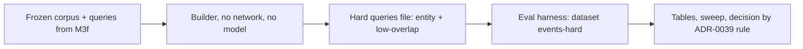

# Spec — hybrid-eval-set (M3g, follow-up of M3f)

## 0. Review guide

- The `events` search eval ties vector and hybrid (0.764 recall@5, 0.660 MRR) and shows no effect of `semantic_rrf_k` or `semantic_candidates` (harder-search-eval verify F-1). Two reasons, both measured: the full-text leg ANDs every query word (`websearch_to_tsquery`), so long paraphrases almost never match (16 relevant hits in the whole run); and the relevant articles are mostly rewordings of one headline, so vector search finds them under any setting.
- This milestone adds a second, **harder query set over the same frozen corpus**: entity queries (the proper names of a story, where exact words matter and the full-text leg can fire) and low-overlap queries (graded only on relevant articles that share under half their words with the seed). No new model calls, no rebuild of the corpus. Then it reruns the sweep and applies the existing ADR-0039 rule.
- Review order: §3 reality → §6 ACs → Decisions.

### Decisions

| ID | Decision | Status |
|---|---|---|
| D-1 | Where the harder queries come from | Decided: entity queries extracted from seed titles (proper names, no model) plus the existing paraphrase queries graded only on low-overlap relevant members (2026-11-04) |
| D-2 | Corpus | Decided: reuse the frozen corpus; only a queries file is added (2026-11-04) |
| D-3 | Relevant articles that are not graded (the high-overlap members of a low-overlap query) | Decided: default, not asked; they are removed from the result lists like the seed, so they neither help nor count as wrong |
| D-4 | What the eval may change | Decided: default, not asked; the ADR-0039 rule unchanged: a setting changes only on a clear paired-bootstrap win and not for the prefix (recommendation only) |
| D-5 | If vector and hybrid still tie | Decided: default, not asked; that is a finding, recorded in ADR-0039's Result with the numbers, and the defaults stay |

**Open risks:** a heuristic name extractor will pick some bad names (a verb, a place used as a noun), and queries made of names alone may have few full-text matches in a 1,557-title corpus; the low-overlap subset is small (33 of 81 relevant members, 32 of 73 clusters), so intervals will be wide.
**Prerequisites the user owns:** none (no network, no Ollama chat model); Ollama with `nomic-embed-text` for the real-model run, as before.

## 1. Problem

The eval that was meant to choose hybrid weighting cannot tell vector from hybrid, so `semantic_rrf_k` and `semantic_candidates` are still unmeasured.

## 2. Goals

- A query set on which the full-text leg matters. Measured by: the full-text recall on the entity queries is above zero (AC-8), against 0.01 to 0.19 on the old kinds.
- A rerun of the sweep and the noise measure on that set, and the defaults kept or changed by the existing rule.
- Learning: designing queries that test one part of a hybrid system; reading a tie honestly.

## 3. Data/reality

- **[verified in code 2026-11-04]** `keyword_leg` uses `websearch_to_tsquery('english', query)` on `to_tsvector('english', title)` (`apps/api/src/newsdock_api/adapters/semantic_repo.py`): terms are combined with AND, so a query matches only titles containing all its words.
- **[verified 2026-11-04]** On the real model, events set: full-text recall 0.103 (keywords 0.19, paraphrase 0.01); vector and hybrid 0.764 / 0.660; the sweep's 24 rows are identical (harder-search-eval verify §3).
- **[verified 2026-11-04]** From the judge log: of 95 judge-confirmed pairs, 35 share under half their significant words with the seed and 23 under 30%.
- **[verified 2026-11-04]** On the frozen fixture: 73 clusters; 51 have 2 or more capitalised names in the seed title and 65 have at least 1 (a naive extractor also returns noise such as "What's", "Wins", "Four"); 32 clusters have a relevant member sharing under half its words with the seed (33 of 81 relevant members).
- **[assumption]** the 0.5 overlap threshold and a 2-to-3 name limit are good starting values.

## 4. Scope (walking skeleton)

**In:** a deterministic builder step that reads the frozen files and writes a hard-queries file; the new dataset `events-hard` in the harness (graded and ignored members); the sweep, noise and report on it; one real-model run and the decision.
**Out:** a new corpus or a rebuild, network, any chat model, a new MCP tool or route, a change to search code, a weighted fusion (separate spec if the result asks for one), body scope.

## 5. Users and key flows

A maintainer runs `make eval-search-build-hard` (instant, offline) after the frozen files change, then `make eval-search` and `make eval-search-sweep` and reads the tables by kind: `entity` and `lowoverlap`.

## 6. Acceptance criteria

AC-1  Names come from the seed title
  Given a seed title with proper names, sentence-initial words and trailing punctuation
  When  the names are extracted
  Then  the result holds at most 3 names, in title order, without punctuation or sentence-initial common words, and an empty list when no name is found
  Verify: auto

AC-2  Entity queries follow the old rules
  Given the entity queries built from the frozen seeds
  When  each is checked
  Then  none is empty or equals, contains or sits inside a corpus title, and each has 2 or more names
  Verify: auto

AC-3  Graded members are the low-overlap ones
  Given a cluster and its relevant members
  When  members are graded
  Then  graded are those sharing under half their significant words with the seed, the others are marked ignored, and a cluster with no graded member makes no low-overlap query
  Verify: auto

AC-4  The hard-queries file is valid
  Given the generated file and the frozen corpus
  When  it is loaded
  Then  every id exists in the corpus, graded and ignored are disjoint subsets of the cluster without the seed, and no query text is repeated within a kind
  Verify: auto

AC-5  The builder is offline and repeatable
  Given the frozen corpus and queries files
  When  the builder runs twice
  Then  it makes no network or model call and writes byte-identical output
  Verify: auto

AC-6  Ignored members are left out of the results
  Given ranked lists that contain the seed and ignored members
  When  they are scored
  Then  both are removed before recall and MRR, so an ignored article neither counts as a hit nor pushes a graded one down
  Verify: auto

AC-7  Harness runs the new dataset
  Given the dataset `events-hard` and a fake embedder
  When  the eval runs
  Then  it prints recall@5 and MRR for the four methods overall and by kind (`entity`, `lowoverlap`) and the hybrid noise line
  Verify: auto

AC-8  Entity queries exercise the full-text leg
  Given the real model and `events-hard`
  When  the eval runs
  Then  the full-text recall on the `entity` kind is above zero
  Verify: manual

AC-9  Sweep runs on the new dataset
  Given the dataset `events-hard` and a fake embedder
  When  the sweep runs
  Then  24 rows are printed with recall@5 and MRR for vector and hybrid, and the clear-win list
  Verify: auto

AC-10  Decision is recorded
  Given the real-model sweep on `events-hard`
  When  the owner reads the result
  Then  ADR-0039's Result names, for prefix, `semantic_rrf_k` and `semantic_candidates`, kept or changed with the numbers, and says whether vector and hybrid differ
  Verify: manual

AC-11  Config stays consistent
  Given a default changed by AC-10 (or none)
  When  `make config-python` runs
  Then  it passes
  Verify: auto

AC-12  Earlier datasets are unchanged
  Given the `easy` and `events` data
  When  this milestone is done
  Then  `corpus.json`, `queries.json`, `search_eval_corpus.json` and `search_eval_queries.json` are byte-identical to before and no search code changed
  Verify: manual

## 7. Non-functional requirements

Provisional targets (measure first): the builder runs in well under a second; the new file is small (tens of KB); the real-model eval stays within a few minutes.

## 8. Assumptions

Capitalised words after the first word of a title are a usable stand-in for proper names; the 0.5 overlap threshold (the same word-overlap measure as the corpus ambiguity rule) separates "reworded" from "different wording"; a tie between vector and hybrid on this set is itself a valid result.

## Glossary

- **Entity query:** a query made of the 2 or 3 proper names of a story, so exact words matter.
- **Low-overlap query:** an existing paraphrase query graded only on relevant members that share under half their significant words with the seed.
- **Graded / ignored member:** a relevant member that counts in recall and MRR / one that is relevant but neither counted nor allowed to push others down.
- **Significant words:** words of more than 3 letters, lower-cased (the harness and builder word-overlap measure).
- **Full-text leg:** hybrid's keyword side, Postgres `websearch_to_tsquery` on the title (terms ANDed).
