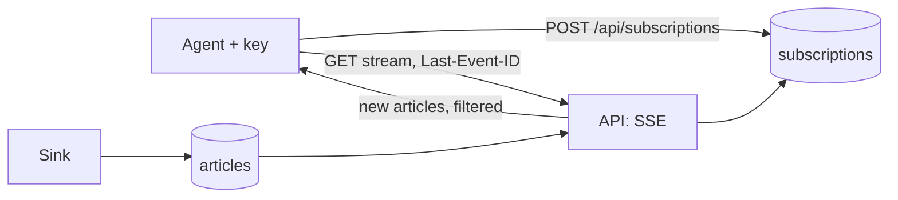

# push-delivery — Spec (Milestone 2, part 2 of 3: saved filters and SSE push)

Status: init approved · 2026-10-14

## 0. Review guide

**In three lines:** after `agent-platform` an agent has an identity and a server-side cursor, but it still has to poll `list_new_articles`. This spec lets an agent save **subscriptions** (a filter on theme, domain and title text) and open a **Server-Sent Events** stream per subscription: matching new articles are pushed as they arrive, each event carrying the cursor as its id so a reconnect resumes without gaps (at-least-once). Webhook and MCP-notification channels are later specs.



**Review order:** §0 decisions → §4 scope → §6 ACs → risks.

### Decisions

| ID | Decision | Status |
|---|---|---|
| D-1 | Cut line | Decided: saved filters + SSE only; webhook and MCP notifications go to the backlog (2026-10-14) |
| D-2 | Filter fields | Decided: the same fields as `search_articles`: theme (exact, or a prefix such as `ECON_`), domain, title text (2026-10-14) |
| D-3 | Delivery guarantee | Decided: at-least-once with resume; event id = the opaque cursor, reconnect with `Last-Event-ID` (2026-10-14) |
| D-4 | Subscription management | Decided: the agent manages its own subscriptions over REST with its API key; it can only touch its own; the admin token can list all (2026-10-14) |
| D-5 | Stream granularity | Decided **[assumption]**: one stream per subscription (`GET /api/subscriptions/{id}/stream`); an article matching two subscriptions appears once on each stream. Conventional default, not asked |
| D-6 | Start position | Decided **[assumption]**: `Last-Event-ID` wins; else the agent's stored server cursor; else the first-run window (same rule as `list_new_articles`). Connecting never moves the stored cursor: only `ack_cursor` does |
| D-7 | Filter semantics | Decided **[assumption]**: all given fields must match (AND); an empty filter matches every article; theme matches an article if any of its themes equals (or starts with, for a `*` suffix) the value |
| D-8 | Change detection | Decided: Postgres `LISTEN/NOTIFY` as a wake-up signal, with the cursor query as the source of truth; a slow fallback poll covers outages (user choice over the recommended per-stream polling, at /spec-design, 2026-10-14) |

No open decisions.

### Open risks
1. **Long-lived connections on one uvicorn worker:** each stream holds a connection and a polling task; a cap per agent (AC-13) bounds it, but memory/DB load under many agents is unmeasured.
2. **Detecting new rows:** the sink is a separate process, so the API listens to a Postgres `NOTIFY` raised by a trigger on `articles` (D-8, ADR-0018). Risks: the trigger adds a little cost to sink writes, and the listener connection must be supervised (reconnect, fallback poll).
3. **Proxy/idle timeouts:** SSE needs keep-alive comments (AC-12); local compose has no proxy, a future cloud deploy may.
4. **Open reads (agent-platform D-7) are unchanged:** the stream itself needs a key, but `GET /api/articles` stays open until `ui-login`.
5. **Duplicates on reconnect are possible by design (at-least-once):** clients must dedupe by `article_id`.

### Prerequisites you own
- None new: the `agent-platform` stack, an agent and its key (`make agent-create`).

## 1. Problem

Polling every minute is wasteful for the agent and adds up to a minute of latency to every article; an agent that only cares about, say, `ECON_` stories from two domains still pulls and filters everything itself.

## 2. Goals and how measured

- An agent receives only the articles it asked for, shortly after they are stored. Measured by AC-6, AC-7 and the live check (AC-14); latency is a provisional target.
- A disconnected agent never silently misses matches. Measured by AC-8, AC-9.
- One agent cannot see or alter another's subscriptions, and cannot hold unlimited connections. AC-3, AC-4, AC-13.
- Learning goals: SSE and long-lived connections in FastAPI, resumable event streams, change detection with `LISTEN/NOTIFY`, per-tenant resource limits.

## 3. Data/reality

- **[verified]** `agent-platform` provides `agents`, `api_keys`, `agent_cursors`, the key middleware (today guarding `/mcp*` only) and a per-agent limiter; `articles.seq` is the monotonic insert order used by cursors (ADR-0004).
- **[verified]** `search_articles` already filters by theme, domain and title text in `SqlArticleRepo.search`; `list_new` pages by `seq` (apps/api).
- **[verified]** The API runs one uvicorn worker (`uvicorn_workers: 1`); the rate limiter is in memory.
- **[assumption]** FastAPI/Starlette can stream `text/event-stream` with a plain `StreamingResponse` and detect client disconnects; confirm with a spike in `/spec-design`/`/spec-plan`.
- **[assumption]** The auth middleware can be extended to guard `/api/subscriptions*` without breaking long-lived responses.
- **[assumption]** New articles arrive in batches roughly every 15 minutes (GDELT slots), so push latency is dominated by ingest, not by delivery.

## 4. Scope of this milestone (walking skeleton)

**In**
- A `subscriptions` table and REST routes for an authenticated agent: create, list own, delete own; filter validation.
- `GET /api/subscriptions/{id}/stream` (SSE) with `Last-Event-ID` resume, start-position rule (D-6), keep-alive, and termination when the key is revoked or the agent disabled.
- A cap on concurrent streams per agent.
- An admin route listing all subscriptions.

**Out (backlog)**
- Webhook and MCP-notification channels; the demo agent consuming the stream; richer filters; UI login and a live UI feed; further quotas.

## 5. Users and key flows

- **Agent author:** `POST /api/subscriptions {filter}` → opens the stream with the key → processes events → on reconnect sends `Last-Event-ID`.
- **Owner/admin:** lists all subscriptions with the admin token for debugging.

## 6. Acceptance criteria

```
AC-1  Create a subscription
  Given an authenticated agent "alpha"
  When  it POSTs /api/subscriptions with {"theme":"ECON_*","domain":"example.com"}
  Then  it gets 201 with a subscription id and the stored filter, and the subscription is still there after the API restarts
  Verify: auto

AC-2  Invalid filters are rejected
  Given an authenticated agent
  When  it POSTs a filter with an unknown field, a non-string value, or an over-long text
  Then  it gets 422 and nothing is stored
  Verify: auto

AC-3  Agents see only their own subscriptions
  Given "alpha" and "beta" each with a subscription
  When  "alpha" lists its subscriptions and requests the stream of beta's subscription
  Then  the list contains only alpha's, and the stream request returns 404
  Verify: auto

AC-4  Agents delete only their own subscriptions
  Given "alpha" and "beta" each with a subscription
  When  "alpha" deletes its own, then tries to delete beta's
  Then  the first returns 204, the second 404, and beta's subscription still exists
  Verify: auto

AC-5  The stream needs a valid key
  Given a subscription and auth_required true
  When  a client opens its stream with no key, an unknown key, or a revoked key
  Then  the response is 401 and no events are sent
  Verify: auto

AC-6  Matching articles are pushed
  Given an open stream for filter {"domain":"example.com"}
  When  a new article from example.com is stored
  Then  the stream emits one event whose data is that article's summary and whose id is its cursor
  Verify: auto

AC-7  Non-matching articles are not pushed
  Given an open stream for filter {"domain":"example.com"}
  When  a new article from other.org is stored
  Then  no event is emitted for it
  Verify: auto

AC-8  Resume after a disconnect
  Given a stream that delivered articles up to event id E, then disconnected, and two matching articles were stored meanwhile
  When  the client reconnects with Last-Event-ID E
  Then  it receives exactly the two missed articles, in order, and no article at or before E
  Verify: auto

AC-9  Default start position
  Given an agent with a stored server cursor C and no Last-Event-ID
  When  it opens a stream
  Then  it first receives matching articles after C; for an agent with no stored cursor, matching articles from the first-run window
  Verify: auto

AC-10  Streaming does not move the server cursor
  Given an agent that received events on a stream
  When  its stored cursor is read
  Then  it is unchanged until the agent calls ack_cursor
  Verify: auto

AC-11  Revocation ends the stream
  Given an open stream
  When  the agent's key is revoked or the agent is disabled
  Then  the server closes the stream, and reconnecting gets 401
  Verify: auto

AC-12  Keep-alive on idle streams
  Given an open stream with no matching articles
  When  the keep-alive interval passes
  Then  the server sends an SSE comment line so the connection stays open
  Verify: auto

AC-13  Concurrent stream cap
  Given a per-agent cap of N concurrent streams
  When  an agent opens N+1 streams
  Then  the N+1th gets 429 and the other agents are unaffected
  Verify: auto

AC-14  Live push on the real stack
  Given the stack is up with a registered agent, a subscription and `curl -N` on its stream
  When  the pipeline ingests a real GDELT slot containing matching articles
  Then  matching articles appear on the stream with event ids, and an unrelated subscription stays silent
  Verify: manual

AC-15  Admin can list all subscriptions
  Given subscriptions of two agents
  When  the admin calls the admin list route with the admin token (and with an agent key, and with none)
  Then  the first returns both agents' subscriptions; the others get 403 and 401
  Verify: auto
```

**Provisional targets — measure first (not ACs):** delivery latency after the article is stored (aim: a few seconds), keep-alive interval (~15 s), fallback poll interval (~30 s), concurrent-stream cap (~5 per agent), max subscriptions per agent (~20), max filter text length (~200 chars).

## 7. Non-functional (this milestone)

- Every stream is authenticated; unauthenticated agents never see events. Auth failures give no hint of which check failed.
- At-least-once: duplicates are allowed on reconnect, gaps are not; events carry the cursor (never raw `seq`, CLAUDE.md).
- New settings follow ADR-0013 (file defaults, env overrides); SQL only in `adapters/`, parameterized; migration forward-only (`0005`).
- A slow or dead client must not block the API or other streams (bounded per-connection work, cleanup on disconnect).

## 8. Assumptions

- Local compose only, one API worker, so in-memory stream accounting is sufficient. **[verified: config]**
- Clients reach the API directly (no proxy buffering). **[assumption]**
- SSE over HTTP/1.1 is acceptable for server-to-agent push (agents are programs, not browsers; browsers' `EventSource` cannot send an Authorization header). **[assumption]**

## Appendix: Glossary

- **Subscription**: a saved filter owned by one agent.
- **Filter**: AND of optional `theme`, `domain`, `text`; empty matches all.
- **SSE (Server-Sent Events)**: HTTP response of type `text/event-stream`, one-way server to client, with `id:`/`data:` fields and `:` comment lines.
- **Event id / Last-Event-ID**: the opaque cursor of the delivered article; the client sends it back to resume.
- **Keep-alive**: periodic SSE comment (`: ping`) that keeps an idle connection open.
- **At-least-once**: an event may be delivered more than once but is never skipped.
- **First-run window**: the default look-back (`first_run_window_minutes`) for an agent with no cursor.
- **LISTEN/NOTIFY**: Postgres pub/sub; a trigger runs `NOTIFY articles_new` after an insert commits and one listener connection receives it.
- **Wake-up**: the notification's only job: tell open streams to re-query; it is never the data they emit.
- **Fallback poll**: a slow periodic re-query (~30 s) that covers notifications missed during a listener outage.
- **Transition table**: the set of rows an `INSERT` statement added, visible to a statement-level trigger; lets one notification cover a whole batch.
- **Concurrent-stream cap**: the maximum simultaneously open streams per agent.
