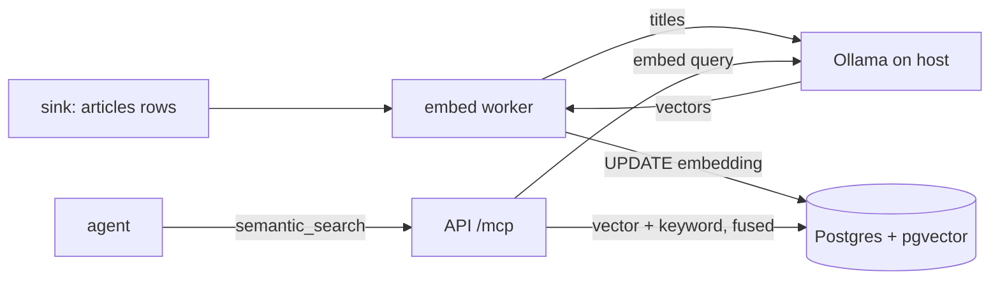

# semantic-search — Spec (Milestone 3, part 1)

Status: init · 2026-10-28 · Backlog: [backlog.md](backlog.md)

## 0. Review guide

**Summary:** embed every canonical article title with a local model, store the vector in the existing pgvector column space, and add an MCP tool `semantic_search` (vector or hybrid with the keyword search) so agents can find articles by meaning, not by title substring. Ingestion never waits on embedding.

**Review order:** §0 decisions → §4 scope → §6 acceptance criteria. The rest is reference.



| ID | Decision | Status |
|---|---|---|
| D-1 | Embedding provider: Ollama on the host (same as the demo agent), model `nomic-embed-text`, 768 dimensions | Decided: default (2026-10-28) |
| D-2 | What is embedded: the article title only (GKG has no body); canonical articles only, not `article_sources` copies | Decided: default (2026-10-28) |
| D-3 | Embedding is decoupled from ingest: an article insert never waits on or fails because of embedding | Decided: default (2026-10-28) |
| D-4 | The query is embedded by the API at request time (the API gets a route to Ollama; the demo agent's AC-13 isolation is unchanged) | Decided: default (2026-10-28) |
| D-5 | Hybrid ranking = reciprocal-rank fusion (RRF) of the keyword and vector result lists | Decided: default (2026-10-28) |
| D-6 | Surface: one new MCP tool `semantic_search`; no REST route and no UI in this milestone | Decided: default (2026-10-28) |
| D-7 | Index: HNSW with cosine distance on the `embedding` column | Decided: default (2026-10-28) |
| D-8 | The keyword side of hybrid is Postgres full-text search (`english`) on the title with a GIN index, not `ILIKE` (found at /spec-design: a natural-language query is almost never a title substring); amends AC-1 | Decided: default (2026-10-28) |
| D-9 | The worker's queue is a partial index on articles still without a vector (`embedding IS NULL`, migration 0009); vectors written by another model are cleared once at worker start so they join that queue (found at /spec-verify 2026-10-29 by measuring on 67k real articles: the first query, `embedding IS NULL OR embedding_model <> :model` over `ORDER BY seq DESC`, walked past every embedded row, 78 ms per idle poll); amends AC-1 and AC-5 | Decided: fix now (2026-10-29) |

**All seven decisions were taken as recommended defaults, not answered one by one:** the user asked for the whole of M3 to be driven through `/spec-*` and had interrupted the question flow earlier. Any of them can be changed before `/spec-design`; D-1 and D-4 are the ones most worth a second look.

**Risks:**
1. `nomic-embed-text` quality on short news titles is unmeasured **[assumption]**; AC-14 measures it against the keyword baseline before anything is claimed.
2. Ollama was not reachable when this spec was written, so the model name, dimension and speed are **[memory]**, not verified.
3. Changing the model later changes the vector space; AC-11 makes mixed models safe instead of silently wrong.

**Prerequisites the user owns:** Ollama running on the host with the embedding model pulled (`ollama pull nomic-embed-text`).

## 1. Problem

`search_articles` only matches the title by substring (`text`), plus theme, domain and time. An agent asking for "interest rate hike" misses "central bank lifts borrowing costs". Agents need to retrieve by meaning.

## 2. Goals and measures

| Goal | Measure |
|---|---|
| Find paraphrases the keyword search misses | AC-7 (fixture), AC-14 (recall@5 on a labelled query set) |
| Embeddings never block or break ingestion | AC-4, AC-3 |
| Existing 7-day data is searchable, not just new rows | AC-5 |
| Learning: embeddings, pgvector, ANN indexes, hybrid ranking | the pieces above exist and are measured |

## 3. Data and reality

- One verified GKG slot had 527 rows with a title on every row (`docs/research.md`) **[verified]**. At 96 slots a day that is about 50k rows a day and about 350k in the 7-day window **[assumption: slots are similar in size]**. Fewer after story dedup.
- The `vector` extension is already created (migration `0001_baseline`) and the compose image is `pgvector/pgvector:0.8.7-pg16-trixie` **[verified: `infra/compose.yaml`]**. No column or index uses it yet **[verified: no `vector` in `packages/db`]**.
- Ollama was **not reachable** on `localhost:11434` this session, so the model's availability, dimension (768) and throughput are unverified **[memory]**.
- GKG has no article body (CLAUDE.md), so the embedded text is the title only **[verified]**.
- Embedding 350k short titles is a batch job, not a request-time cost; the throughput of `nomic-embed-text` on the owner's machine is unknown **[assumption]** and is a first thing `/spec-design` should measure in a spike.

## 4. Scope (walking skeleton)

**In**
- Migration: `articles.embedding vector(768)` (nullable), `articles.embedding_model text` (nullable), HNSW cosine index, GIN full-text index on the title (D-8), partial index on rows without a vector (D-9).
- Embed worker: finds canonical rows with no embedding for the configured model, embeds titles in batches through Ollama, writes the vector and model name; idempotent; retries when Ollama is down.
- Backfill of rows already in the window (the same loop covers them).
- MCP tool `semantic_search(query, mode, limit, time_from, time_to, theme, domain)`, `mode` = `vector` or `hybrid` (default `hybrid`).
- Config: model, dimension, Ollama URL, batch size, poll interval in `newsdock.yaml` (ADR-0013).
- A small labelled eval set and a script that prints recall@5 for keyword, vector and hybrid.

**Out**
- Article bodies, chunking, long-text embeddings (M3 body extraction is separate).
- Re-ranking with a cross-encoder or an LLM.
- REST route and UI search bar (separate; see backlog).
- Fuzzy grouping of rewritten duplicates (dedup backlog, builds on this later).
- Hosted embedding APIs; multilingual-specific models.
- Embedding `article_sources` copies.

## 5. Users and flows

- **Agent author** calls `semantic_search` with a natural-language query and gets articles ranked by similarity, with a score, in the same summary shape as `search_articles`.
- **Operator** starts Ollama with the model; the worker catches up on its own; `make` target runs the eval.
- Flow: sink writes article → worker embeds it → agent query is embedded → nearest neighbours (+ keyword list) → fused → returned.

## 6. Acceptance criteria

```
AC-1  Schema
  Given a database at the previous migration head with articles in it
  When  the new migration runs
  Then  articles has nullable embedding (vector 768) and embedding_model columns, an HNSW cosine index and a GIN full-text index on the title, and (migration 0009, D-9) a partial index on seq for rows without a vector; every existing row and its other columns are unchanged
  Verify: auto

AC-2  New article gets embedded
  Given Ollama is up and a canonical article exists with no embedding
  When  the embed worker runs one pass
  Then  the article has a 768-dimension embedding and embedding_model equal to the configured model
  Verify: auto

AC-3  Idempotent
  Given every canonical article already has an embedding for the configured model
  When  the embed worker runs another pass
  Then  no embedding request is sent and no row is rewritten
  Verify: auto

AC-4  Ollama down does not touch ingestion
  Given Ollama is unreachable
  When  the sink inserts new articles and the embed worker runs
  Then  the inserts succeed, the new rows stay without embedding, and the worker logs the failure and retries on a later pass
  Verify: auto

AC-5  Backfill
  Given articles in the window that were stored before the migration
  When  the embed worker runs until it reports nothing left to do
  Then  every canonical article in the window has an embedding, and picking the next batch uses the partial index (its cost does not grow with the rows already embedded)
  Verify: auto

AC-6  Vector search returns nearest first
  Given three articles with known embeddings at different cosine distances from a query vector
  When  an agent calls semantic_search with mode=vector
  Then  the articles come back ordered by ascending distance, each with a similarity score between -1 and 1
  Verify: auto

AC-7  Finds a paraphrase keyword search misses
  Given a stored article titled "Central bank lifts borrowing costs" and no title containing "interest rate hike"
  When  an agent calls semantic_search mode=vector with query "interest rate hike", and search_articles with text "interest rate hike"
  Then  the first returns that article and the second does not
  Verify: auto (needs the real model; marked integration)

AC-8  Hybrid fuses both lists
  Given article A matches both the keyword and the vector list, article B only the vector list, article C only the keyword list
  When  an agent calls semantic_search with mode=hybrid
  Then  A ranks above B and above C, and B and C both appear
  Verify: auto

AC-9  Filters apply
  Given matching articles on different domains, themes and dates
  When  semantic_search is called with domain, theme (including a trailing * prefix) and a time range
  Then  only articles that satisfy every given filter are returned, in both modes
  Verify: auto

AC-10  Ollama down at query time
  Given Ollama is unreachable
  When  an agent calls semantic_search with mode=vector, and then with mode=hybrid
  Then  vector returns a tool error "embedding_unavailable"; hybrid returns the keyword results with "degraded": true; search_articles still works
  Verify: auto

AC-11  Mixed models are never compared
  Given some rows embedded with model X and the configured model is Y
  When  semantic_search runs and the embed worker runs
  Then  rows with model X are excluded from vector results and are re-embedded with Y by the worker
  Verify: auto

AC-12  Same auth and limits as other tools
  Given auth is required
  When  semantic_search is called without a valid agent key, and when an agent exceeds its per-minute rate limit
  Then  the first is rejected as unauthorized and the second is rate limited, exactly as for the other MCP tools
  Verify: auto

AC-13  Retention removes vectors
  Given an article older than the retention window with an embedding
  When  the sink's retention pass runs
  Then  the article row, and with it the embedding, is gone and never returned
  Verify: auto

AC-14  Measured against the keyword baseline
  Given a labelled set of queries with the article ids that should match, over a fixed fixture corpus
  When  the eval script runs
  Then  it prints recall@5 for keyword, vector and hybrid, and exits 0 (no pass threshold: measure first)
  Verify: auto (script runs) + manual (owner reads the numbers)

AC-15  Config is external
  Given the layered config (ADR-0013)
  When  model, dimension, Ollama URL, batch size or poll interval is set in newsdock.yaml or the environment
  Then  the worker and the tool use it, and `make config-python` finds no tunable literal in code
  Verify: auto
```

Provisional targets — measure first: embedding throughput (titles/second), time to backfill the window, p95 `semantic_search` latency, and hybrid vs keyword recall@5. None of these is a requirement yet.

## 7. Non-functional requirements

- Layering per CLAUDE.md directory rules: pure ranking logic (RRF, filters) in `domain/`, Ollama and SQL in `adapters/`; SQL parameterized; no env reads outside `config.py`.
- A new deployable (the embed worker) needs an ADR (CLAUDE.md: new app needs an ADR); `/spec-design` decides whether it is a new app or part of an existing one.
- Healthcheck for the worker follows ADR-0015.
- Embedding failures never cause a dead letter or a retry storm: bounded batch and backoff.

## 8. Assumptions

- **[verified: spike.md, 2026-10-28]** `nomic-embed-text` produces 768-dim vectors through Ollama's `/api/embed`. Whether it ranks English news titles well is measured by AC-14, not assumed.
- **[assumption]** English-first titles; non-English titles are embedded as they are and may rank poorly.
- **[assumption]** A single worker is enough; the window is about 350k titles.
- **[assumption]** pgvector 0.8 HNSW handles this size on a laptop (no sharding).
- **[assumption]** The API container can reach Ollama through `host.docker.internal` like the agent does.

## Appendix: glossary

| Term | Meaning |
|---|---|
| Embedding | A fixed-length vector of numbers that represents the meaning of a text |
| pgvector | Postgres extension that stores vectors and does nearest-neighbour search |
| HNSW | Approximate nearest-neighbour index (graph based); fast, slightly inexact |
| Cosine distance | 1 minus the cosine of the angle between two vectors; small = similar |
| recall@5 | Share of the expected articles that appear in the top 5 results |
| RRF | Reciprocal-rank fusion: score = sum over lists of 1/(k + rank); merges ranked lists without comparing raw scores |
| Hybrid search | Keyword and vector results combined into one ranking |
| Canonical | The one article kept per story; other copies live in `article_sources` |
| Ollama | Local model server the project already uses for the demo agent |
