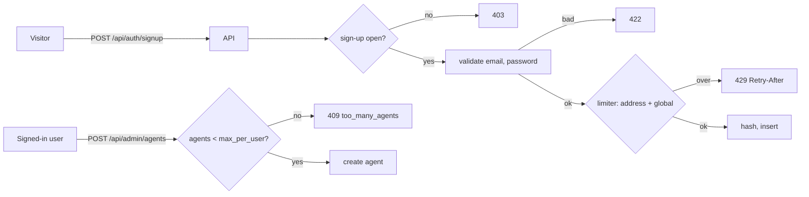

# signup-rate-limit — Spec (M2e: limit account sign-ups, cap agents per user)

Status: init approved 2026-10-28 · design approved 2026-10-28 (no ADR needed) · implemented and verified 2026-10-28 (pass with follow-ups, see [verify.md](verify.md))

## 0. Review guide

**In three lines:** sign-up is open, so anyone who can reach the API can create unlimited accounts, and since agent-ownership every account can create agents and API keys. This spec adds an in-memory **sign-up limiter** (a per-address limit plus one global cap, per time window, answering 429 with `Retry-After`) and a **per-user agent quota** (409 above the cap; the `owner` role and the admin token are exempt). Both limits are settings, with 0 meaning off.



**Review order:** §0 decisions → §4 scope → §6 ACs → risks.

### Decisions

| ID | Decision | Status |
|---|---|---|
| D-1 | Limit key for sign-up | Decided: per client address **and** one global cap (user choice 2026-10-28) |
| D-2 | Cut line | Decided: sign-up limiter **plus** a per-user agent quota (user choice 2026-10-28; the sign-up-only option was recommended) |
| D-3 | What counts | Decided **[assumption]**: every sign-up request that passes the closed-check and input validation counts, whether it ends 201 or 409 (a duplicate email still costs an argon2 hash). Requests rejected with 403 or 422 do not count |
| D-4 | Over the limit | Decided **[assumption]**: HTTP 429, `detail: too_many_signups`, a `Retry-After` header in seconds; no account is created; the web shows a plain message |
| D-5 | Algorithm and defaults | Decided **[assumption]**: fixed window (like the login limiter), in memory, valid for one API worker, restart resets it. Provisional defaults: 5 sign-ups per address and 50 in total per 60-minute window; settings `auth_signup_max_per_address`, `auth_signup_max_total`, `auth_signup_window_minutes`; 0 turns a limit off |
| D-6 | Which address | Decided **[assumption]**: the socket peer address (`request.client.host`). `X-Forwarded-For` is not trusted (a client can forge it); a deployment behind a reverse proxy needs a trusted-proxy setting, which is out of scope |
| D-7 | Agent quota | Decided **[assumption]**: `agents_max_per_user` (default 10, 0 = off) counts all agents a user owns, disabled ones included; creating one more answers 409 `too_many_agents`. The `owner` role and the admin token are exempt. Follows the existing `subscriptions_max_per_agent` precedent |

No open decisions.

### Open risks
1. **Address collapse behind Docker.** On Docker Desktop every local caller may reach the API through the same bridge address, so the per-address limit behaves like a second global limit locally. The global cap is why D-1 asks for both; defaults must be generous enough not to lock out a normal household of users **[assumption]**.
2. **Sign-up can be starved on purpose.** A flood that uses up the global cap blocks real sign-ups until the window ends. It is the price of any limiter; `auth_signup_open: false` and the owner creating accounts later remain the escape hatches.
3. **Per-process memory.** Counters live in one API worker and reset on restart; more than one worker would multiply the limits (same limit as the login and agent limiters).
4. **Forgeable headers are ignored, but a proxy hides the real address.** If the API is ever fronted by a proxy, every client shares the proxy's address until a trusted-proxy setting exists (backlog).
5. **First account.** A flood before the first owner signs up could use the budget; unlikely and recoverable (wait for the window, or close sign-up).

Prerequisites the user owns: none.

## 1. Problem

`POST /api/auth/signup` has no limiter (ui-login risk 1, accepted then as "open sign-up, the user's choice"). A script can create thousands of `viewer` accounts, each with an argon2id hash (CPU cost) and a row. Since agent-ownership every viewer can also register agents and issue API keys, which can read articles and write analyses through MCP, so an account is now worth more to an abuser. Nothing limits how many agents one user may create either.

## 2. Goals and how they are measured

| Goal | Measure |
|---|---|
| One address cannot create accounts faster than the limit | AC-1, AC-2 |
| All sign-ups together stay under a global cap | AC-3 |
| Limits recover and can be switched off | AC-4, AC-8 |
| Junk requests do not use up the budget, real attempts do | AC-5, AC-6 |
| The limiter cannot be used to exhaust server memory | AC-9 |
| A user cannot hoard agents | AC-11, AC-12, AC-13 |
| The web explains both refusals | AC-10, AC-14 |

Learning goal: a second, differently keyed in-memory limiter with a bounded table and an injectable clock, and a resource quota enforced where the resource is created.

## 3. Data and reality findings

- `POST /api/auth/signup` validates the email and password, then hashes and inserts; it has no limiter (`adapters/accounts_api.py`) **[verified]**.
- The login limiter (`domain/loginlimit.py`) is per normalized email, fixed window from the first failure, `max_failures == 0` disables, entries pruned with a hard cap of 10 000, injectable clock **[verified]**. Settings `auth_login_max_failures` and `auth_login_window_minutes` exist in `config.py` and `infra/config/newsdock.yaml` **[verified]**.
- The agent request limiter (`domain/ratelimit.py`) returns a `Decision(allowed, retry_after)` that the new limiter can reuse **[verified]**.
- The precedent for a count cap is `subscriptions_max_per_agent` (default 20, 409 `too_many_subscriptions` above it) **[verified]**.
- The browser calls the API directly with credentialed CORS, so the API sees the browser's own address for local browsers; behind Docker Desktop port publishing the peer address may be the bridge gateway **[assumption]** (to be measured at /spec-design).
- Agent creation is `POST /api/admin/agents`, scoped by `AgentScope` (ADR-0023); a session creates with its user id as `owner_id` **[verified]**.
- `make config-python` fails on unknown keys, values that differ from code defaults and tunable literals in code **[verified]**, so every new number must be a setting.

## 4. Scope of this milestone (walking skeleton)

**In**
- A sign-up limiter in the domain (pure, injectable clock): per-address window plus global window, bounded memory, 0 = off.
- `POST /api/auth/signup` consults it after the closed-check and input validation; 429 with `Retry-After` when over.
- Settings `auth_signup_max_per_address`, `auth_signup_max_total`, `auth_signup_window_minutes` and `agents_max_per_user`, in `Settings` and `infra/config/newsdock.yaml`.
- A per-user agent quota in `POST /api/admin/agents` (409 `too_many_agents`; owner role and token exempt), backed by a count of the user's agents.
- Web: sign-up form shows a message for 429; the Agents page shows one for 409 `too_many_agents`.
- Docs updated in the same change (CLAUDE.md, README, ADR amendment or new ADR if the design needs one, ui-login backlog item closed, agent-ownership backlog quota item closed).

**Out**
- CAPTCHA, email verification, invites, proof-of-work, IP allow/deny lists.
- Trusted-proxy handling or `X-Forwarded-For`.
- Persistent counters (Postgres or Redis) and multi-worker correctness.
- Changes to the login limiter or the agent request limiter.
- Per-user quotas on subscriptions, keys or analyses; quota changes through the UI.

## 5. Users and key flows

- **Visitor**: signs up as before; a burst from one address eventually gets a 429 with a wait time and the form says to try again later.
- **Signed-in user**: creates agents up to the quota; at the cap, the Agents page says the limit is reached. Disabled agents still count and agents cannot be deleted yet, so the cap is a hard stop until the operator raises `agents_max_per_user` (deleting agents is in the backlog).
- **Owner role / operator**: no quota; can still close sign-up with `auth_signup_open: false`.

## 6. Acceptance criteria

```
AC-1  One address is limited
  Given auth_signup_max_per_address is 3 and the window is 60 minutes
  When  the same address makes 4 valid sign-ups with different emails
  Then  the first three return 201, the fourth returns 429 with detail too_many_signups and a Retry-After header, and no fourth account exists
  Verify: auto

AC-2  Other addresses are unaffected
  Given address A has used its whole per-address budget
  When  address B signs up with a valid new email
  Then  B gets 201
  Verify: auto

AC-3  The global cap holds
  Given auth_signup_max_total is 4 and auth_signup_max_per_address is 10
  When  five different addresses each make one valid sign-up
  Then  four return 201 and the fifth returns 429 with a Retry-After header
  Verify: auto

AC-4  The window recovers
  Given a limit has been reached and the injected clock is at the start of the window
  When  the clock moves past auth_signup_window_minutes and the same address signs up again
  Then  it gets 201
  Verify: auto

AC-5  Invalid and closed requests do not consume budget
  Given auth_signup_max_per_address is 2
  When  one address sends five sign-ups with an invalid email or a too-short password, then one valid sign-up
  Then  the five return 422 and the valid one returns 201; and with auth_signup_open false every request returns 403 and the limiter holds no entry
  Verify: auto

AC-6  Duplicate attempts count
  Given auth_signup_max_per_address is 2 and a@x.io already exists
  When  one address signs up with a@x.io twice, then with a new valid email
  Then  the first two return 409 and the third returns 429
  Verify: auto

AC-7  The first account is still the owner
  Given the users table is empty and the limits are at their defaults
  When  the very first sign-up arrives
  Then  it returns 201 and the new account has role owner
  Verify: auto

AC-8  Zero switches a limit off
  Given auth_signup_max_per_address and auth_signup_max_total are 0
  When  one address makes 50 valid sign-ups
  Then  all return 201
  Verify: auto

AC-9  The limiter's memory is bounded
  Given the limiter with a small table cap
  When  more distinct addresses sign up than the cap allows
  Then  the tracked entries never exceed the cap and the newest addresses are still limited correctly
  Verify: auto

AC-10  The sign-up form explains a 429
  Given the sign-up route answers 429 with Retry-After 120
  When  the user submits the sign-up form
  Then  the form shows a message that sign-ups are limited and to try again in about 2 minutes, and stays on the page
  Verify: auto

AC-11  The agent quota stops the next agent
  Given agents_max_per_user is 2 and a viewer already owns two agents, one of them disabled
  When  that viewer creates a third agent
  Then  the response is 409 with detail too_many_agents and no third agent exists
  Verify: auto

AC-12  The owner role and the token are exempt
  Given agents_max_per_user is 2
  When  an owner-role user and the admin token each create three agents
  Then  all six creations return 201
  Verify: auto

AC-13  The quota is per user
  Given user A is at the quota
  When  user B creates an agent
  Then  B gets 201
  Verify: auto

AC-14  The Agents page explains the quota
  Given the create-agent route answers 409 too_many_agents
  When  the user submits the new-agent form
  Then  the page shows a message that the agent limit is reached
  Verify: auto

AC-15  The settings are visible and consistent
  Given the new settings exist in Settings and in infra/config/newsdock.yaml
  When  make config-python runs
  Then  it passes (no unknown keys, file values equal the code defaults, no tunable literals in code)
  Verify: auto
```

**Provisional targets — measure first:** the defaults (5 per address and 50 in total per 60 minutes; 10 agents per user) are guesses; at /spec-verify record the peer address seen from a browser through Docker Desktop and whether 5 per hour is enough for a normal household.

## 7. Non-functional requirements

- Refused sign-ups do no hashing and no database write (the limiter runs before the argon2 hash).
- The limiter table is bounded and pruned (AC-9); counters never hold an email or password.
- The limiter adds no I/O; time is injectable for tests.

## 8. Assumptions

- **[assumption]** One API worker (same as the existing limiters).
- **[assumption]** The peer address is the real client address for local use; behind a proxy it is not (out of scope).
- **[assumption]** The defaults in D-5 and D-7 are reasonable for a local multi-user deployment.
- **[verified]** `max == 0` as "off" is the existing convention (`auth_login_max_failures`, `rate_limit_per_minute`).

## Glossary

- **Per-address limit:** the number of sign-up attempts one peer address may make per window.
- **Global cap:** the number of sign-up attempts all addresses together may make per window.
- **Window:** a fixed period starting at the first counted attempt; the count resets when it ends.
- **Counted attempt:** a sign-up request that passed the closed-check and input validation (D-3).
- **Agent quota:** `agents_max_per_user`, the most agents one non-owner user may own (D-7).
- **Peer address:** the socket address of the TCP client as the API sees it (`request.client.host`).
- **Owner role / admin token:** the see-all user role and the operator credential, both exempt from the quota (agent-ownership).
