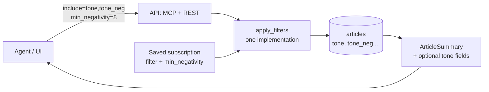

# tone-in-summary — Spec (M3b: tone in article lists, opt-in, and a negativity filter)

Status: init approved 2026-10-30 · design approved 2026-10-30 (ADR-0030 Accepted) · plan approved 2026-10-30 (9 tasks, 21 tests) · implemented and verified 2026-10-30 (pass with follow-ups, all 15 ACs; see [verify.md](verify.md))

## 0. Review guide

**In three lines:** the platform stores GDELT tone for almost every article, but the lists agents page through (`list_new_articles`, `search_articles`, `semantic_search`, the REST feed) do not return it, so an agent that wants "the stories people worry about" would need one `get_article` call per article. This spec adds an optional `include` argument that adds tone fields to each article in those lists (default payload unchanged), completes the article detail, and adds a `min_negativity` filter (on `tone_neg`) to the search tools, the REST feed and saved subscriptions. No migration: the columns already exist.



**Review order:** §0 decisions → §4 scope → §6 ACs → risks.

### Decisions

| ID | Decision | Status |
|---|---|---|
| D-1 | How tone reaches the summary | Decided: an **argument chooses the fields** (user choice 2026-10-30; the "tone + tone_neg always" option was recommended). Design: opt-in extras through an optional `include` list; **without it the payload is exactly today's** |
| D-2 | Which names `include` accepts | Decided **[assumption]**: `tone`, `tone_pos`, `tone_neg`, `tone_polarity` (the four stored tone numbers). `word_count` and other fields are not offered. Duplicates are ignored; an unknown name is an error (D-6) |
| D-3 | Where `include` and the filter apply | Decided: `search_articles`, `semantic_search` and the REST feed take both `include` and `min_negativity`; saved subscriptions take `min_negativity` (they reuse the same filter) (user choice 2026-10-30). `list_new_articles` takes `include` only: it is a cursor feed and has no filters today |
| D-4 | Filter | Decided: `min_negativity` (user choice 2026-10-30). **[assumption]** meaning: keep articles whose stored `tone_neg` is **greater than or equal to** the value; articles with no `tone_neg` never match; the value must be a number from 0 to 100; it is ANDed with every other filter |
| D-5 | Missing tone | Decided **[assumption]**: when a field is requested and the article has no value, the key is present with `null`; when it is not requested the key is absent |
| D-6 | Bad input | Decided **[assumption]**: an unknown `include` name or an out-of-range or non-numeric `min_negativity` is rejected, never ignored. MCP: tool error `invalid_include` / `invalid_filter`; REST and subscriptions: HTTP 422 |
| D-7 | Article detail | Decided **[assumption]**: `get_article` and `GET /api/articles/{id}` always return all four tone numbers (today only `tone`); the change is additive |
| D-8 | Streams and live feed | Decided **[assumption]**: unchanged payload. Subscription streams apply `min_negativity` as a filter but do not take `include` |
| D-9 | Scale | Decided **[assumption]**: values are returned as stored (GDELT scale), no normalisation. Observed on the dev data: `tone` from −40.0 to 31.5, `tone_neg` from 0 to 40.0 |
| D-10 | REST spelling | Decided **[assumption]**: query parameters `include=tone,tone_neg` (comma separated) and `min_negativity=8` on the feed; JSON field `min_negativity` in a subscription body |

No open decisions.

### Open risks
1. **Tone is a blunt "worry" signal.** It measures word sentiment, not importance: crime and court stories score very negative, awards and press releases very positive. It helps a consumer rank, it does not decide for them (see Data/reality).
2. **Filter cost.** `min_negativity` filters a column that has no index, on a table that holds seven days of rows. The time filters narrow it first in most calls, but a call with no other filter scans the table. Measure first; an index is a backlog item **[assumption]**.
3. **Contract drift.** `ArticleSummary` is shared by MCP, REST, semantic hits and the generated web types; a field added in one place and not the others would split the contract. The design must keep one model and one filter implementation.
4. **Cursor feed has no filter.** A consumer of `list_new_articles` still reads every article and filters on its side; that is the accepted cost of D-3.
5. **Per-process nothing.** No new state, limiter or setting is added, so the usual single-worker caveats do not apply.

Prerequisites the user owns: none.

## 1. Problem

Agents that rank or triage news need to know how negative a story is. The platform parses GDELT's tone and stores it in `articles`, but the article summary that every list returns has no tone, and the article detail returns only the overall `tone` number. To use tone an agent must call `get_article` for each article, which is one call per article for roughly 2 600 articles an hour, against a rate limit. There is also no way to ask the platform for only the strongly negative stories, so every consumer downloads everything and filters alone.

The immediate consumer is the `whathappen` digest agent, whose top-5 block should show what people worry about; any other agent or the UI can use the same fields.

## 2. Goals with how each is measured

| Goal | Measured by |
|---|---|
| Tone is available in a list call | AC-2 to AC-5: a list call with `include` returns the requested numbers for every article, with no extra call |
| Nothing breaks for existing consumers | AC-1: without `include`, summaries have exactly today's keys |
| An agent can ask for only strongly negative stories | AC-9 to AC-12: `min_negativity` returns only rows at or above the value, in search, REST and subscriptions |
| One contract | AC-15: OpenAPI and the generated web types carry the new fields; the filter has one implementation (AC-10) |
| Learning goal | the same shared-model, one-filter design used for `semantic_search` is reused, with a change that stays additive |

## 3. Data / reality

Checked on the dev database and the code in this session.

- `articles` has columns `tone`, `tone_pos`, `tone_neg`, `tone_polarity` (REAL, nullable; migration `0002`, model `newsdock_db.models`) and a `word_count` **[verified]**. The sink writes them from the parsed V2Tone **[verified]**. No migration is needed.
- Dev database: 175 061 articles, 175 046 with `tone` and `tone_neg` set (15 are NULL) **[verified]**. `tone` ranges −40.0 to 31.5, average −0.38; `tone_neg` ranges 0 to 40.0, average 3.44 **[verified]**. GDELT defines tone_neg as a percentage, so 0 to 100 is the possible range **[memory]**.
- In the last 24 hours the most negative titles are a hate-crime guilty plea, riots with stun grenades, a jail suicide, a manslaughter charge and a kidnapping sentence; the most positive are awards pages and market-report spam **[verified]**. 3 794 articles published in that period have `tone_neg ≥ 8` **[verified]**. So tone separates violent or tragic news from promotional text, but much of what it ranks highest is local crime: it needs coverage (`source_count`) next to it to find what matters most.
- `ArticleSummary` (`apps/api/.../domain/records.py`) has no tone fields; `ArticleDetail` has `tone` and `word_count` only **[verified]**. The summary is built in `adapters/repo.py:_summary` and `semantic_repo.py`, and `SemanticHit` extends it **[verified]**.
- `search_articles` and `semantic_search` filter by `time_from`, `time_to`, `theme`, `domain` and `text` through one function, `apply_filters` **[verified]**. `list_new_articles` takes only `cursor` and `limit` **[verified]**. A saved subscription's filter is a model with `theme`, `domain`, `text` and `extra="forbid"`, and it is matched in SQL by the same code **[verified]**.
- The web client's types are generated from `apps/web/src/lib/api/openapi.json` into `types.ts` **[verified]**; they must be regenerated, not edited.

## 4. Scope of the milestone (walking skeleton)

The thinnest slice that lets an agent read tone for a page of articles and ask for only the negative ones, end to end, on real data.

**In**
- Optional `include` on `search_articles`, `semantic_search`, `list_new_articles` and the REST feed (`GET /api/articles`), adding the chosen tone fields to each article (D-1, D-2, D-3, D-5).
- `get_article` / `GET /api/articles/{id}` return all four tone numbers (D-7).
- `min_negativity` on `search_articles`, `semantic_search`, the REST feed and the subscription filter, through the one filter implementation (D-4).
- Input validation and errors (D-6).
- OpenAPI and generated web types regenerated; docs that list the fields updated (CLAUDE.md fixed names, API docs, the `semantic-search` filter notes).
- Tests at unit, API-contract and database level on the real schema.

**Out**
- Showing tone in the web UI (no new screen or badge).
- Using the fields in the `whathappen` agent (its own change, after this ships).
- Sorting or ranking by tone, and an index on `tone_neg`.
- A filter on `list_new_articles` (cursor semantics), and `include` on the SSE streams and live feed.
- Any change to how tone is parsed or stored; `word_count` in lists; normalising or re-scaling values.
- A positive-tone or other-field filter (only `min_negativity`).

## 5. Users and key flows

- **Digest agent (first user).** Pages `list_new_articles(limit=200, include=["tone_neg"])`, ranks story groups by coverage and negativity, and writes the top block. No extra calls.
- **Triage agent.** Calls `search_articles(theme="ARMEDCONFLICT*", min_negativity=10, include=["tone","tone_neg"])` to get only the strongest items, with the numbers.
- **Alerting agent.** Creates a subscription `{"min_negativity": 15}` and reads its stream; only strongly negative articles arrive.
- **Human on the website.** Nothing changes on screen; the REST feed accepts the same parameters for scripts.

## 6. Acceptance criteria

```
AC-1  Default payload unchanged
  Given articles with stored tone values
  When  an agent calls list_new_articles, search_articles or semantic_search, or GET /api/articles, without include
  Then  every article has exactly the keys it has today and no tone key
  Verify: auto
```

```
AC-2  include on search_articles
  Given articles whose tone is 4.0 and tone_neg is 9.5
  When  an agent calls search_articles with include ["tone_neg"]
  Then  each article has a tone_neg value equal to its stored value and no other tone key
  Verify: auto
```

```
AC-3  include on list_new_articles
  Given a page of new articles with stored tone values
  When  an agent calls list_new_articles with include ["tone", "tone_neg"]
  Then  each article carries tone and tone_neg, and the cursor and page size behave as without include
  Verify: auto
```

```
AC-4  include on semantic_search
  Given embedded articles with stored tone values
  When  an agent calls semantic_search in "vector" mode and in "hybrid" mode with include ["tone_neg"]
  Then  each hit carries tone_neg together with its score and matched_by
  Verify: auto
```

```
AC-5  include on the REST feed
  Given articles with stored tone values and a logged-in session
  When  the client calls GET /api/articles?include=tone,tone_neg
  Then  each article carries tone and tone_neg
  Verify: auto
```

```
AC-6  Unknown include name
  Given any list call
  When  include contains a name that is not one of tone, tone_pos, tone_neg, tone_polarity
  Then  MCP answers the tool error invalid_include, REST answers 422, and no articles are returned
  Verify: auto
```

```
AC-7  Missing tone value
  Given an article whose tone and tone_neg are NULL
  When  a list call asks for include ["tone", "tone_neg"], and when it asks for nothing
  Then  the first response has both keys with null and the second has neither
  Verify: auto
```

```
AC-8  Detail returns all tone numbers
  Given an article with tone, tone_pos, tone_neg and tone_polarity stored
  When  get_article or GET /api/articles/{id} is called
  Then  the response carries all four numbers
  Verify: auto
```

```
AC-9  min_negativity on search_articles
  Given articles with tone_neg 3.0, 8.0, 12.5 and one with NULL
  When  an agent calls search_articles with min_negativity 8
  Then  the 8.0 and 12.5 articles are returned (8.0 included), and the 3.0 and NULL ones are not
  Verify: auto
```

```
AC-10  One filter in both search legs
  Given embedded articles with mixed tone_neg values
  When  an agent calls semantic_search in "vector" and in "hybrid" mode with min_negativity 8
  Then  no hit has tone_neg below 8 in either leg, and the result is the same set as search_articles would filter
  Verify: auto
```

```
AC-11  min_negativity on the REST feed
  Given articles with mixed tone_neg values and a logged-in session
  When  the client calls GET /api/articles?min_negativity=8
  Then  only articles with tone_neg of 8 or more are returned
  Verify: auto
```

```
AC-12  min_negativity in a subscription
  Given an agent with a subscription whose filter is {"min_negativity": 8}
  When  new articles with tone_neg 3.0 and 12.5 arrive and the agent reads the stream
  Then  only the 12.5 article is delivered
  Verify: auto
```

```
AC-13  Invalid min_negativity
  Given any call that accepts min_negativity
  When  the value is below 0, above 100, NaN or infinite, or (on REST and in a subscription) a non-number or a boolean
  Then  MCP answers the tool error invalid_filter, REST and subscription creation answer 422, and nothing is stored or returned;
        a non-number, a numeric string or a boolean sent to an MCP tool fails the tool's own (strict) argument validation with a tool error (design 2026-10-30, spike.md (c))
  Verify: auto
```

```
AC-14  Filters combine with AND
  Given articles that differ in theme, domain, time and tone_neg
  When  min_negativity is sent together with theme, domain, text and a time range
  Then  only articles that satisfy every filter are returned
  Verify: auto
```

```
AC-15  One contract
  Given the API after the change
  When  the OpenAPI document is generated and the web types are generated from it
  Then  the committed openapi.json and types.ts equal the generated output, and show include, min_negativity and the new detail fields
  Verify: auto
```

## 7. Non-functional requirements

- **Additive only.** No existing field changes name, type or position of meaning; a consumer that never sends `include` sees no difference (AC-1).
- **Parameterized SQL only,** and the filter lives once in `apply_filters` (CLAUDE.md rule).
- **No new setting, table, migration or dependency.**
- **Provisional targets — measure first:** the latency of `search_articles` with `min_negativity` on the dev table, and the payload growth of a 200-article page with all four fields. No numbers are promised until measured.

## 8. Assumptions

- The four tone columns are filled by the sink for new rows; the 15 NULL rows are the only gaps **[verified]** on the dev data, not checked on other databases.
- The existing consumers ignore unknown extra keys, which only matters if a future change makes `include` the default **[assumption]**.
- A comma-separated query parameter is enough for the REST list of fields **[assumption]**.

## Appendix: Glossary

- **Tone (V2Tone):** GDELT's sentiment numbers for an article, parsed into `tone` (overall, positive minus negative), `tone_pos`, `tone_neg`, `tone_polarity` (how emotional) and `word_count`.
- **tone_neg:** the share of the text GDELT scores as negative; larger means more negative.
- **Summary / `ArticleSummary`:** the short article shape returned by every list; the **detail** is the full shape of one article.
- **`include`:** the optional list that adds tone fields to each article in a list response.
- **`min_negativity`:** the filter that keeps articles with `tone_neg` at or above a value.
- **`apply_filters`:** the single function that applies the search filters to a query (used by search, semantic search and subscriptions).
- **Subscription filter:** the saved filter of a push subscription; matched in SQL by the same code as search.
- **Cursor feed:** `list_new_articles`, which pages by an opaque cursor instead of filters.
- **Canonical article:** the one row that stands for a story grouped from several copies (`source_count`).
