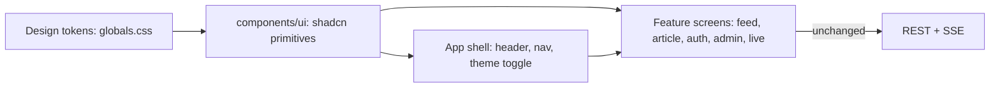

# ui-design — Spec (Milestone M2c: a modern, clean, readable UI on shadcn/ui)

Status: init approved · 2026-10-27

## 0. Review guide

**In three lines:** the Next.js UI works (feed, article, login, management screens, live feed) but is plain unstyled HTML. This spec restyles every existing screen with **shadcn/ui on Tailwind CSS**, in the spirit of the LINE website: friendly, airy, rounded, one green accent, light and dark. **No behaviour, API or data change.**



**Review order:** §0 decisions → §4 scope → §6 ACs → risks.

### Decisions

| ID | Decision | Status |
|---|---|---|
| D-1 | Component stack | Decided: shadcn/ui (copied into `src/components/ui`) on Tailwind CSS v4, `lucide-react` icons, `next-themes` for the theme (user asked for shadcn, 2026-10-27) |
| D-2 | Visual direction | Decided: LINE-website-inspired: white space, large radius, friendly type, one green accent (LINE green is about `#06C755` **[memory]**; exact token chosen in design), neutral greys. Inspiration only; no LINE logo, font or asset |
| D-3 | Themes | Decided: light and dark, follows the system by default, manual toggle remembered in the browser (assumption, conventional default) |
| D-4 | Scope | Decided: every existing screen (feed, article, login, sign-up, users, agents, subscriptions, live) and the app shell. No new features, no API or behaviour change, existing web tests stay green (user: "finish", "modern, human read, nice, clean", 2026-10-27) |
| D-5 | Typography | Decided: system font stack with CJK-safe fallbacks; no web-font download at build or run time (the images build offline-friendly, assumption) |
| D-6 | Verification of looks | Decided: tests assert structure and tokens; looks are checked by hand with screenshots at 375 px and 1280 px, light and dark (no visual-regression tooling in this spec) |

No open decisions. The user chose the stack and direction in the request; D-3, D-5, D-6 are conventional defaults recorded as assumptions.

**Open risks**
1. shadcn components assume Tailwind v4 and React 19; Next 16.3 compatibility is **[assumption]** until the first task installs them.
2. The root rule "`components/` shared UI without data fetching" fits `components/ui`; the layout check (`check_layout.py`) and `format:check` must accept the generated files.
3. Many existing tests query by role or text; restyling can break them if markup changes. Keep accessible names stable.
4. Docker image: Tailwind v4 needs its native binary at build time **[assumption]**; the web Dockerfile must still build (AC-14).

**Prerequisites the user owns:** a look at screenshots at verify time (the "nice" call is subjective).

## 1. Problem

The UI built in M1 and M2 (`apps/web`, about 2,400 lines of TSX) is correct but unstyled: default browser fonts, no layout, no visual hierarchy, no dark mode. It is hard to scan a feed of 100 headlines or to trust the admin screens. The owner (a frontend engineer) also wants it to be a portfolio-quality front end.

## 2. Goals

| Goal | How it is measured |
|---|---|
| Every screen uses one shared design system | AC-1, AC-2: shadcn primitives and tokens only, no stray hard-coded colours |
| A feed that is pleasant to scan | AC-4 structure; manual screenshot review (AC-10) |
| Light and dark both look right | AC-9, AC-11 |
| Works on a phone | AC-10 |
| Accessible by default | AC-11 (contrast, focus, reduced motion) |
| Nothing else changes | AC-12 |
| Learning: Tailwind v4, shadcn composition, design tokens, theming in Next | portfolio goal, no metric |

## 3. Data / reality

- **[verified 2026-10-27]** npm registry: `shadcn` CLI 4.23.0, `tailwindcss` 4.3.3, `lucide-react` 1.62.0, `next-themes` 0.4.6.
- **[verified]** `apps/web` today: Next 16.3.8, React 19.2.8, no CSS file, no Tailwind, no UI library; 8 routes (`/`, `/articles/[id]`, `/login`, `/signup`, `/live`, `/admin/{users,agents,subscriptions}`); features under `src/features/*`, each with tests (vitest + Testing Library).
- **[verified]** Repo rule: `components/` is shared UI without data fetching; `features/<name>/` holds feature code; `lib/api/` is generated and never hand-edited.
- **[verified]** The ui-login backlog already lists "Unstyled UI (P3): a design pass belongs with the UI work in a later milestone".
- **[memory]** shadcn/ui is not a package: the CLI copies component source into the repo, built on Radix UI primitives and Tailwind; v4 supports Tailwind v4 and React 19.
- **[assumption]** GDELT titles are mixed-language (`docs/research.md`), so long or CJK titles must wrap, not overflow.

## 4. Scope of the milestone (walking skeleton)

Thinnest slice that proves the system: **tokens + shell + feed**, then the rest of the screens reuse it.

In:
- Tailwind v4, shadcn setup (`components.json`), tokens for light and dark in one `globals.css`.
- Primitives actually used: Button, Input, Label, Card, Badge, Table, Alert, Skeleton, AlertDialog, Separator, Sonner/toast for action feedback, theme toggle (no DropdownMenu: see AC-3).
- App shell: header with wordmark, nav with active state and role-gated links, user menu (logout), theme toggle, host-mismatch alert restyled.
- Restyle all 8 routes; loading, empty and error states with shared components.
- Live page: connection status indicator and a gentle enter animation that respects reduced motion.

Out:
- New features (search, filters, drill-down), API changes, new routes.
- Logo and brand assets, i18n, web fonts.
- Visual-regression tooling, Storybook.
- Changing the generated client, auth, session or CORS logic.

## 5. Users and key flows

- **Viewer** opens `/`, scans the feed, opens an article, watches `/live`.
- **Admin** manages agents, keys, subscriptions; **owner** also users.
- **Anyone** signs up or logs in; toggles dark mode; uses a phone.

## 6. Acceptance criteria

```
AC-1  Design system installed
  Given a clean checkout
  When  `pnpm --dir apps/web run build` runs
  Then  it succeeds with Tailwind v4 and shadcn configured (`components.json` present, primitives under `src/components/ui`)
  Verify: auto

AC-2  Tokens are the only source of colour
  Given the source under `apps/web/src` (excluding generated and `components/ui`)
  When  a check greps for hard-coded colour values (hex, rgb(), hsl() literals, Tailwind palette classes such as `bg-green-500`)
  Then  none are found; colours come from semantic token classes (`bg-background`, `text-muted-foreground`, `bg-primary`, ...)
  Verify: auto

AC-3  App shell
  Given a logged-in admin
  When  any page renders
  Then  a header shows the wordmark, nav links for the role (viewer: Feed, Live; admin adds Agents, Subscriptions; owner adds Users) with the current page marked `aria-current="page"`, a user area (email, role badge, Log out button), and the theme toggle (changed at /spec-design 2026-10-27: inline user area instead of a dropdown, to keep Log out a plain control)
  Verify: auto

AC-4  Feed cards
  Given the API returns articles with title, domain, published time, themes and `source_count`
  When  `/` renders
  Then  each article is a card showing the title (link to its page), domain, relative time, up to a few theme badges, and a "+N sources" badge when `source_count` > 1; long and CJK titles wrap inside the card
  Verify: auto

AC-5  Article detail
  Given an article that has analyses with agent payloads
  When  `/articles/<id>` renders
  Then  fields appear in Card/Badge layout and agent payloads are still escaped text, never HTML
  Verify: auto

AC-6  Auth forms
  Given the login and sign-up pages
  When  a user submits invalid or rejected input
  Then  the error appears inline in an Alert tied to the form (`role="alert"`), fields keep their labels, and the submit button shows a pending state
  Verify: auto

AC-7  Management screens
  Given the users, agents and subscriptions screens
  When  they render with data
  Then  lists use Table (cards on narrow screens are allowed), role and status use Badge, destructive actions (revoke, remove) ask for confirmation in a dialog, and a newly issued API key is shown once in a copyable panel exactly as today
  Verify: auto

AC-8  Live page
  Given `/live` with an open event stream
  When  the stream connects, drops and delivers items
  Then  a status indicator shows connected or reconnecting, new items animate in, and the animation is disabled under `prefers-reduced-motion`
  Verify: auto

AC-9  Dark mode
  Given a first visit with the system set to dark
  When  any page loads and the user toggles the theme
  Then  the page is dark without a light flash, the toggle switches and the choice is remembered in the browser
  Verify: manual

AC-10  Responsive
  Given each of the 8 routes at 375 px and 1280 px width
  When  viewed
  Then  there is no horizontal page scroll and content stays readable (screenshots reviewed in light and dark)
  Verify: manual

AC-11  Accessibility basics
  Given the token palette
  When  a script computes contrast of each foreground/background token pair in light and dark
  Then  body and muted text meet WCAG AA (4.5:1) and every interactive element shows a visible focus ring
  Verify: auto

AC-12  No behaviour change
  Given the existing web tests, `typecheck`, `lint` and `format:check`
  When  `make check-web` runs
  Then  all pass, `src/lib/api/` is unchanged, and no file outside `apps/web` and docs changes
  Verify: auto

AC-13  Loading, empty and error states
  Given the feed, live page and management screens
  When  data is loading, empty or failed
  Then  a Skeleton, a friendly empty state or an Alert is shown (shared components, not ad-hoc text)
  Verify: auto

AC-14  Container still works
  Given the web image built from `apps/web/Dockerfile`
  When  the container serves `/login`
  Then  the response links a CSS file that returns 200 with Tailwind output (styles ship in the image)
  Verify: auto
```

**Provisional targets (measure first, not ACs):** first-load CSS under about 50 kB gzipped; Lighthouse accessibility score 95 or more on `/` and `/login`.

## 7. Non-functional requirements

- No new runtime network dependency (no CDN, no web fonts).
- Dark mode must not cause a hydration warning or a flash.
- Keep `components/ui` generated code unedited where possible so the CLI can update it.

## 8. Assumptions

1. Tailwind v4 and the shadcn CLI work with Next 16.3 and pnpm 12 here (checked in task 1).
2. System fonts are good enough for the "nice" goal.
3. The user reviews screenshots at verify; there is no designer.
4. `check_layout.py` and the web `CLAUDE.md`/`AGENTS.md` rules need no change beyond allowing `components/ui` (confirm in design).

## Glossary

- **shadcn/ui:** a set of accessible UI components whose source is copied into your repo (built on Radix UI and Tailwind), not installed as a library.
- **Tailwind CSS v4:** utility-first CSS framework; v4 configures theme tokens in CSS (`@theme`) instead of `tailwind.config.js`.
- **Design token:** a named value (colour, radius, spacing) such as `--primary`, used through semantic classes so themes can swap it.
- **Semantic token class:** a Tailwind class named for its role (`bg-card`, `text-muted-foreground`), not its colour.
- **Radix UI:** unstyled, accessible primitives (dialog, dropdown) that shadcn wraps.
- **next-themes:** small library that sets the `dark` class on `<html>` and remembers the choice without a flash.
- **lucide-react:** icon set used by shadcn.
- **WCAG AA:** accessibility contrast level: 4.5:1 for normal text.
- **`prefers-reduced-motion`:** browser setting asking apps to minimise animation.
- **Walking skeleton:** thinnest end-to-end slice that proves the chain.
