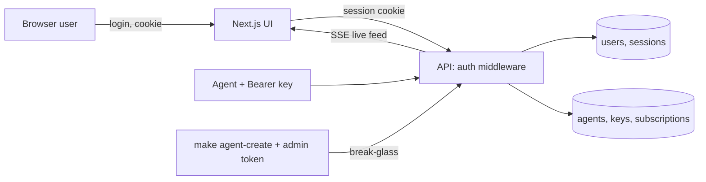

# ui-login — Spec (Milestone 2, part 3 of 3: human accounts, roles, sessions, management screens)

Status: init approved · 2026-10-27 · design approved · 2026-10-27 (added D-9, D-10, AC-16) · implemented 2026-10-27 · verified 2026-10-27 (pass with follow-ups, see verify.md)

## 0. Review guide

**In three lines:** today the web UI reads articles anonymously and humans manage agents with one shared `NEWSDOCK_ADMIN_TOKEN`. This spec adds **user accounts** (self-sign-up, argon2 passwords), **roles** (owner / admin / viewer), **server-side sessions**, and **login-gated UI and article reads**. On top of that it adds UI screens for **users, agents and keys, subscriptions, and a live feed**. Agents keep using API keys; nothing about MCP auth changes.



**Review order:** §0 decisions → §4 scope → §6 ACs → risks.

### Decisions

| ID | Decision | Status |
|---|---|---|
| D-1 | Cut line, accounts model | Decided: multi-user accounts + roles (agent-platform D-4, 2026-10-14) |
| D-2 | Read access | Decided: login required for UI reads; `GET /api/articles*` accepts a session or an agent key, anonymous gets 401 when `auth_required` is true. Closes agent-platform D-7 / R-1 (2026-10-27) |
| D-3 | Account creation | Decided: open self-sign-up (user choice, 2026-10-27; the recommended option was bootstrap owner + invites). Guard rails below are **[assumption]**: new accounts are `viewer`; the very first account becomes `owner`; `auth_signup_open` flag (default `true`) turns sign-up off |
| D-4 | Roles | Decided: `owner` (users + everything), `admin` (agents, keys, subscriptions), `viewer` (read articles, live feed) (2026-10-27). **Amended 2026-10-28 by [agent-ownership](../agent-ownership/spec.md) D-2/D-3:** every role manages its own agents, keys and subscriptions; `owner` additionally sees all agents; `admin` and `viewer` now have the same permissions |
| D-5 | UI scope | Decided: login/logout, user management, agent registry with create/revoke key, subscriptions screen and live feed page (user chose options 1 + 2, 2026-10-27; the backlog had the live feed at P3) |
| D-6 | Sessions and passwords | Decided **[assumption]**: random opaque session id in an `httpOnly`, `SameSite=Lax` cookie, stored hashed in Postgres with idle and absolute expiry; passwords hashed with argon2id (ADR-0016 already says so). Conventional default, not asked |
| D-7 | Admin token | Decided **[assumption]**: `NEWSDOCK_ADMIN_TOKEN` stays only as a break-glass path for the CLI (`make agent-create`); the UI path uses roles. Admin routes accept the token or an admin/owner session |
| D-8 | Live feed source | Decided **[assumption]**: the live feed is a session-authenticated SSE stream of new articles with an optional ad-hoc filter. It is not a saved subscription and not bound to an agent |
| D-9 | Owner recovery | Decided: `make user-reset-password EMAIL=<email>` sets a new password through a token-only admin route (user choice, 2026-10-27, at /spec-design) |
| D-10 | Browser to API | Decided: credentialed CORS, no proxy (ADR-0021, 2026-10-27, at /spec-design) |

No open decisions.

### Open risks
1. **Open sign-up on a service that holds article data and agent keys (D-3).** Anyone who can reach the web port can register a `viewer` account and read articles. Mitigations: viewer is read-only, `auth_signup_open: false` closes it, README states it. No email verification in this milestone.
2. **Cookie vs. cross-origin (decided D-10, ADR-0021).** Credentialed CORS needs page and API on one hostname and an Origin allowlist as the CSRF guard; the web server redirects to the API's host.
3. **Brute force on login.** Mitigated by a per-account/IP failure limit (AC-13); no CAPTCHA, no MFA.
4. **First-account race.** Two simultaneous first sign-ups must not both become owner (needs a DB-level guard).
5. **SSE through the Next.js layer** (buffering, timeouts) is untested in this repo **[assumption]**.

Prerequisites the user owns: none beyond a local `.env`; no email provider, no OAuth app.

## 1. Problem

Anyone who reaches the API can read every article, and managing agents needs a shared secret pasted into a terminal. There is no notion of who a human is, so there are no per-person permissions and no way to give a colleague read-only access. Saved filters and streams exist (`push-delivery`) but cannot be seen or managed from the UI.

## 2. Goals and how they are measured

| Goal | Measure |
|---|---|
| Humans have accounts with roles | AC-1…AC-3, AC-9, AC-10 |
| Reads are no longer anonymous | AC-7, AC-8 |
| Agents and keys are managed in the UI | AC-11, AC-14 |
| Subscriptions are visible and a live feed works | AC-12, AC-15 |
| Credentials are handled safely | AC-4…AC-6, AC-13, AC-16; NFR-1 |

Learning goals: password storage and session design, cookie security, role-based authorization, authenticated SSE in a browser, Next.js auth middleware.

## 3. Data and reality findings

- **[verified 2026-10-27]** API routes today: `GET /api/articles`, `GET /api/articles/{id}`, `GET /api/health` (open); `/api/subscriptions` (agent key, `POST/GET/DELETE`, `GET /{id}/stream` SSE); `/api/admin/agents`, `/keys`, `/disable`, `/enable`, `/api/admin/subscriptions` (admin token).
- **[verified 2026-10-27]** `apps/api/.../config.py` sets `cors_allow_methods = "GET"` and local origins only, so state-changing browser calls need a config or proxy change (state before this spec; ADR-0021 chose credentialed CORS and T-07 changed the defaults).
- **[verified 2026-10-27]** Latest migration is `0005_subscriptions`; this spec adds users and sessions as `0006`.
- **[verified 2026-10-27]** `apps/web/src` has `app/`, `components/`, `features/{article,feed}`, `lib/{api,config}`; the UI reads only public REST.
- **[verified 2026-10-27, T-01 spike, headless Chrome]** A page on `http://localhost:3000` that logs in against `http://localhost:8000` gets an `httpOnly; SameSite=Lax` cookie and sends it on credentialed `fetch` and on `EventSource` with `withCredentials`; the browser's automatic `Last-Event-ID` on reconnect passes CORS. Against `http://127.0.0.1:8000` from the `localhost` page the cookie is not sent (401), so hostname alignment is required. Only Chrome was tested; Safari and Firefox are **[memory]**. Browsers' `EventSource` cannot set custom headers, so a cookie session suits SSE (this is why the agent stream needs a key header and the human one does not).
- **[assumption]** argon2 library choice (`argon2-cffi`) and its parameters are decided at design.

## 4. Scope of this milestone (walking skeleton)

**In**
- `users` and `sessions` tables, sign-up, login, logout, "who am I", with argon2id hashing.
- Roles `owner` / `admin` / `viewer`, enforced server-side on every route.
- Article read routes require a session or an agent key when `auth_required` is true.
- Next.js: `/login`, `/signup`, auth gate for all other pages, navigation by role.
- Screens: users (owner), agents and keys (admin+), subscriptions (admin+, view and delete), live feed (all roles).
- Login failure rate limit; `auth_signup_open` and session lifetime settings in `newsdock.yaml`.
- Admin routes accept admin/owner session or the admin token (D-7).
- Owner recovery: `make user-reset-password` through a token-only admin route (D-9).

**Out** (backlog)
- Email verification, password reset by email, invites, OAuth/SSO, MFA, CAPTCHA.
- Per-user API tokens, audit log, key rotation overlap, key scopes.
- Webhook or MCP-notification delivery; the demo agent consuming the stream.
- Editing or creating subscriptions in the UI (agents own them); richer filters.
- TLS and cloud deployment (M5).

## 5. Users and key flows

- **Visitor** signs up (becomes `viewer`; the first ever account becomes `owner`), logs in, lands on the feed.
- **Viewer** browses articles and the live feed. Management links are hidden and the routes return 403.
- **Admin** creates an agent, copies the key once, revokes keys, disables agents, views and deletes subscriptions.
- **Owner** also lists users and changes roles or removes users.
- **Agent** is unchanged: `Authorization: Bearer ndk_…` on `/mcp`, `/api/subscriptions*` and article reads.
- **Operator** can still run `make agent-create` with the admin token, and `make user-reset-password` when an owner is locked out.

## 6. Acceptance criteria

```
AC-1  Sign-up creates a viewer
  Given sign-up is open and no account has email a@x.io
  When  a visitor posts email a@x.io and a valid password to the sign-up route
  Then  a user with role viewer exists, the stored password is an argon2id hash (never the plaintext), and the response contains no hash
  Verify: auto

AC-2  First account becomes owner
  Given the users table is empty
  When  two sign-ups arrive at the same time
  Then  exactly one resulting account has role owner and the other has role viewer
  Verify: auto

AC-3  Bad sign-up is rejected
  Given an account with email a@x.io exists
  When  a visitor signs up again with a@x.io, or with a password shorter than the configured minimum, or with auth_signup_open false
  Then  the response is 409, 422 or 403 respectively and no row is created
  Verify: auto

AC-4  Login sets a session
  Given an account a@x.io with a known password
  When  the user logs in with the right password
  Then  the response sets a session cookie that is httpOnly and SameSite=Lax, and "who am I" returns the user's email and role
  Verify: auto

AC-5  Wrong credentials do not leak
  Given an account a@x.io exists and no account b@x.io exists
  When  login is tried with a wrong password for a@x.io and with any password for b@x.io
  Then  both responses are 401 with the same body, and no session is created
  Verify: auto

AC-6  Logout and expiry end the session
  Given a logged-in session
  When  the user logs out, or the session passes its idle or absolute lifetime
  Then  the old cookie gets 401 on "who am I" and on article reads
  Verify: auto

AC-7  Article reads need a session or a key
  Given auth_required is true
  When  GET /api/articles is called anonymously, with a valid session, and with a valid agent key
  Then  the responses are 401, 200 and 200, and GET /api/health stays 200 anonymously
  Verify: auto

AC-8  The UI gates its pages
  Given an anonymous browser
  When  it opens the feed page
  Then  it is redirected to /login, and after a correct login it shows the article list
  Verify: manual

AC-9  Roles are enforced on the server
  Given one viewer, one admin and one owner session
  When  each calls the agent-management routes and the user-management routes
  Then  viewer gets 403 on both, admin gets 200 on agents and 403 on users, owner gets 200 on both
  Verify: auto

AC-10  Owner manages roles safely
  Given an owner and a viewer
  When  the owner promotes the viewer to admin, and later tries to demote or delete the only owner
  Then  the promotion succeeds and the last-owner change is refused with 409
  Verify: auto

AC-11  Agents and keys from the UI
  Given a logged-in admin
  When  they create an agent, and then revoke its key, in the agents screen
  Then  the key secret is shown exactly once on creation, the revoked key gets 401 on /mcp, and the screen never shows the secret again
  Verify: manual

AC-12  Subscriptions screen
  Given two agents with subscriptions
  When  an admin opens the subscriptions screen and deletes one
  Then  both agents' subscriptions are listed with their owner agent, and the deleted one is gone from the list and its stream gets 404
  Verify: auto

AC-13  Login attempts are limited
  Given a configured maximum of failed logins per window
  When  that many wrong passwords are sent for one account
  Then  the next attempt, even with the right password, gets 429 with Retry-After until the window passes
  Verify: auto

AC-14  Admin token still works for the CLI
  Given NEWSDOCK_ADMIN_TOKEN is set
  When  an admin route is called with the token and no session
  Then  it succeeds, and with a wrong token it returns 401
  Verify: auto

AC-15  Live feed
  Given a logged-in user on the live feed page
  When  a new article row is committed to the database
  Then  it appears on the page without a reload within the keep-alive/notify delay, and an anonymous request to the stream returns 401
  Verify: manual

AC-16  Owner recovery by CLI
  Given an account a@x.io with an active session and NEWSDOCK_ADMIN_TOKEN set
  When  the reset-password route is called with the admin token, and then with an admin session
  Then  the token call returns 204, the old password and the old session get 401, the new password logs in, and the session call returns 403
  Verify: auto
```

Provisional targets (measure first, not requirements): argon2 time per hash under about 200 ms on the dev machine; idle session 12 h and absolute 7 d; login limit 5 failures per 15 min; minimum password length 10; maximum password length 128 and email length 254 (input bounds); session `last_seen_at` refreshed at most once a minute; at most 3 concurrent live-feed streams per user.

## 7. Non-functional requirements

- NFR-1 Secrets: passwords, session ids and API keys are never logged or returned after creation; only hashes are stored.
- NFR-2 All SQL parameterized and only in `adapters/`; env read only in `config.py`; new tunables go in `infra/config/newsdock.yaml` (ADR-0013).
- NFR-3 Agent paths (MCP, subscriptions, keys) behave exactly as before (regression suite stays green).
- NFR-4 UI renders user-supplied text (emails, agent names, filters) as escaped text.

## 8. Assumptions

- Local docker-compose, plain HTTP; `Secure` cookie flag is configurable and off locally **[assumption]**.
- One browser origin set (`WEB_PORT`) is enough; no custom domains.
- `auth_required=false` (dev mode) opens article reads and the live feed and removes the UI gate, matching agent-platform D-5; user and agent management stay behind a principal (refined at /spec-design, 2026-10-27) **[assumption]**.

## Glossary

- **Account / user**: a human identity (email + password hash + role).
- **Role**: `owner`, `admin` or `viewer`; higher roles include lower permissions.
- **Session**: server-side record behind an opaque cookie; ends on logout or expiry.
- **Idle / absolute lifetime**: time since last use / time since login after which a session dies.
- **argon2id**: memory-hard password hashing algorithm; used for passwords only (API keys use sha256 because they are high-entropy).
- **Agent key**: `ndk_<prefix>_<secret>` bearer token for agents (agent-platform).
- **Admin token**: shared secret in `.env` for the CLI; break-glass after this spec.
- **Live feed**: browser SSE stream of newly stored articles for a logged-in user.
- **CORS (credentialed)**: browser rule that lets a page on one origin call the API on another and send cookies; the API names the allowed origins and sets `Access-Control-Allow-Credentials`.
- **CSRF**: a forged request made from another site or app using the victim's cookie; blocked here by `SameSite=Lax`, JSON-only bodies and an Origin allowlist.
- **Origin check**: the API rejects a state-changing request whose `Origin` header is not in `cors_origins`.
- **Principal**: the resolved caller of a request: user (with role), agent, admin token or anonymous.
- **Hostname alignment**: page and API use the same hostname (`localhost` or `127.0.0.1`) so the cookie is sent; the web server redirects to the API's host when they differ.
- **Advisory lock**: a Postgres application-level lock used so only one sign-up or role change decides "first owner" or "last owner" at a time.
- **Break-glass**: an emergency access path kept outside the normal login.
