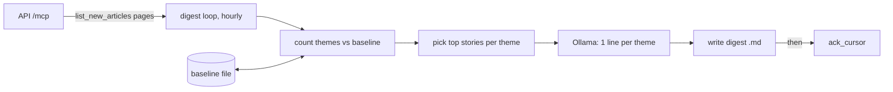

# what-happen — Spec (M2g: an hourly "what happened" digest agent, a test harness for the server)

Status: init, design and plan approved 2026-10-30 (ADR-0028) · implemented and verified 2026-10-30 (pass with follow-ups, see [verify.md](verify.md))

## 0. Review guide

**In three lines:** an independent agent server (`agents/whathappen`, its own project, Docker image and `.env`) wakes every hour, pulls the new articles through MCP, counts themes in plain Python (which themes are rising against the last hours), and asks a local Ollama model for a one-line summary per rising theme. It writes one small markdown digest per hour in which **every story is a link**, then acknowledges the server cursor. It exists to exercise the server end to end (cursor, key, rate limit, real data), not to be a product.



**Review order:** §0 decisions → §4 scope → §5 the digest sample → §6 ACs → risks.

### Decisions

| ID | Decision | Status |
|---|---|---|
| D-1 | Where the code lives | Decided (changed 2026-10-30, [ADR-0029](../../adr/0029-whathappen-as-an-independent-agent-server.md)): an **independent agent server** in its own folder `agents/whathappen/`: own project and lockfile, Dockerfile, compose file and `.env`, no platform code, talks to newsdock only over MCP and to the host's Ollama. First chosen the same day: a module in `apps/agent` (ADR-0028, superseded: it mixed two agents in one app, one image and one key prefix) |
| D-2 | How it runs | Decided: a long-running hourly loop run as its own compose service (`agents/whathappen/compose.yaml`, started separately from the platform with `make up`), plus `make once` for one cycle (user choice 2026-10-30) |
| D-3 | Digest shape | Decided: grouped by rising theme, one section per theme with a one-line model summary and its top linked stories (user choice 2026-10-30; "top stories first" was recommended) |
| D-4 | The window | Decided **[assumption]**: everything since the agent's last `ack_cursor` (the server resumes it; a brand-new agent gets the last hour). The cursor is acked only after the digest file is written, so a crash re-reads the same window |
| D-5 | Model | Decided **[verified]** by the T-01 spike (2026-10-30): default `qwen3:4b-instruct` (more concrete than `llama3.2:3b`, same speed, see spike.md §3). The model gets only theme labels and titles, never counts |
| D-6 | Output | Decided **[assumption]**: `<output_dir>/YYYY-MM-DD/HHMM.md` (run time, atomic write) plus `<output_dir>/latest.md`; the same text is also logged to stdout. `output_dir` is a host bind mount (`agents/whathappen/output/`, git-ignored; a root `digests/` fails the layout check, spike §4) so you open the files directly |
| D-7 | "Rising" | Decided **[assumption]**: a theme's score is this window's count divided by its average per-hour count over the stored baseline (last 24 hourly entries); a minimum count (provisional 5) keeps rare themes out. With fewer than 3 stored hours the digest ranks by plain count and says so. The baseline is a small JSON file in the agent state volume; a missing or corrupt file means a cold start, never a crash. Refined in design 2026-10-30: the usual count is the pooled baseline share times this window's article count, which equals the per-hour average for equal-size windows (AC-4 unchanged) and stays fair after a restart or a catch-up window |
| D-8 | Theme names | Decided **[assumption]**: themes pass a configurable skip-list of generic prefixes (filled from real data in T-01: `TAX_,WB_,EPU_,CRISISLEX_,USPEC_,UNGP_,GENERAL_,MEDIA_,SOC_,LEADER,AFFECT`) and are shown as the code with underscores as spaces (`ECON_INFLATION` → `ECON INFLATION`). No label table in this spec |
| D-9 | Model failure | Decided **[assumption]**: if Ollama fails or times out for a theme, that section shows its links and "summary unavailable"; the digest is still written and the cursor acked. The model never blocks the pipeline |

No open decisions.

### Open risks
1. **Window size.** Measured: about 2 560 articles per hour, read in 13 pages in 0.5 s **[verified]**; a catch-up after a long stop is bounded by `max_articles` (20 000).
2. **Small models invent.** A 3–4B model summarising headlines may add details that are not in the titles. Mitigation: the prompt allows only the given titles and the digest footer says "from headlines only"; a bad summary is a finding about the model, not a failure of this spec.
3. **GDELT themes are noisy and loosely grouped.** The skip-list is filled from real data, but even specific themes group unrelated headlines (spike §2.5); the model then writes a vague line. The links stay useful; real coherence needs story clustering (backlog). Whether rising themes on a warm baseline group better is checked in T-11.
4. **Cold baseline.** For the first 3 hours the "rising" ranking is just volume; that is accepted and labelled in the file.
5. **Shared agent image and key.** The digest service uses its own registered agent (its own cursor), not the demo agent's key; two loops sharing one cursor would steal each other's articles. The README says to run `make agent-create NAME=whathappen`.

Prerequisites the user owns: `ollama serve` running on the host with the chosen model pulled; an agent key for the digest service in `.env`.

## 1. Problem

The server is only exercised by the financial-scoring demo agent, which looks at one article at a time. Nothing reads the data as a whole: whether the cursor, key and rate limit hold up for a batch consumer, and whether the stored themes and story grouping say anything useful about the world. A person also has no quick way to see "what happened in the last hour" in the data we ingest.

## 2. Goals and how they are measured

| Goal | Measure |
|---|---|
| Exercise the server as a batch consumer (paging, cursor, key) | AC-1, AC-2, AC-3, AC-16 (live run) |
| Find out which themes are rising, deterministically | AC-4, AC-5, AC-14 |
| A digest that is quick to scan and every item is clickable | AC-6, AC-7, AC-8, AC-12 |
| The local model only writes prose, and its failure is harmless | AC-9, AC-10 |
| Runs unattended every hour | AC-13, AC-11 |

Learning goal: a batch consumer with at-least-once semantics (ack after durable write), a baseline kept as small local state, and prompting a small model with pre-digested input.

## 3. Data and reality findings

- `list_new_articles(cursor, limit)` returns `{articles, next_cursor}`; without a cursor an authenticated agent resumes from its last `ack_cursor`, a new agent gets the last hour (`adapters/http.py`) **[verified]**.
- `ack_cursor` moves forward only, is safe to repeat, and errors for anonymous callers (auth off) **[verified]**.
- An article summary has `article_id`, `title`, `url`, `domain`, `published_at`, `themes`, `source_count` (copies of the story, M2a) **[verified]**; no body exists, GKG has none (`docs/research.md`) **[verified]**.
- The platform's demo agent has a synchronous MCP client and an Ollama client; `agents/whathappen` carries its own small copies so it shares no code with the platform; its settings use the prefix `WHATHAPPEN_` and contain no database or Kafka fields **[verified]**.
- Host Ollama has `llama3.2:3b`, `qwen3:4b-instruct`, `llama3.2:1b` and `nomic-embed-text` **[verified]**.
- Measured by T-01 on the live stack (2026-10-30, [spike.md](spike.md)) **[verified]**: about 2 560 articles per hour; the most frequent themes are generic taxonomy codes; `published_at` can be years off (so no window range from it); titles contain HTML entities; theme groups are only loosely coherent at hour scale.

## 4. Scope of the first milestone = a walking skeleton

**In**
- The agent server `agents/whathappen` (pure `domain/`: windowing, theme counting, ranking, markdown rendering; `adapters/`: MCP paging, Ollama prompts, file and baseline I/O).
- Its own `Dockerfile` and `compose.yaml` (own network only, reaches the platform's published port and the host's Ollama through the host, `./output` bind mount for digests and the baseline), `.env` / `.env.example`, `Makefile`, README.
- Settings `WHATHAPPEN_*` (interval, directory, minimum theme count, themes shown, stories per theme, article cap, model) as `WHATHAPPEN_*` environment variables or in the agent's own `.env`.
- A README section and a `make once` convenience (one cycle, for testing).

**Out**
- Web UI page for digests, database storage of digests, any new MCP tool or API change.
- Article bodies, translation, regions, email or chat delivery.
- Judging summary quality automatically (read the files; backlog).
- A trusted baseline across restarts longer than 24 hours (older entries age out).

## 5. The digest (what the file looks like)

Target for readability: one screen, links first, no tables.

```markdown
# What happened · 2026-10-30 14:07 UTC (1 840 articles · since 13:07)

> From headlines only. Summaries are written by a small local model and can be wrong; open the links.

## 1. ECON INFLATION · ×3.4 vs usual · 58 stories
Central banks signal inflation is easing but warn about energy prices.
- [ECB holds rates as inflation cools](https://example.com/a) · reuters.com · 14 sources
- [US CPI eases for third month](https://example.com/b) · apnews.com · 9 sources
- [Japan inflation hits 2-year low](https://example.com/c) · nikkei.com · 4 sources

## 2. NATURAL DISASTER · ×2.1 vs usual · 31 stories
…
```

Rules: at most N themes (provisional 8) and K stories (provisional 3) each; a story appears once, under its highest-ranked theme; stories sort by `source_count` then newest; a theme line shows its rise factor, or "no baseline yet" in the first hours.

## 6. Users and key flows

User: the owner of the dev stack, reading the files or `latest.md`.

1. `make up` runs the digest service; at start and then every hour it runs one cycle.
2. A cycle pages through new articles, builds the digest, writes the file, acks the cursor, updates the baseline, sleeps.
3. The owner opens `agents/whathappen/output/latest.md` and clicks into the stories that matter.

## 7. Acceptance criteria

```
AC-1  Reads the whole window
  Given a fake MCP server whose list_new_articles returns 3 pages (page size 200, last page short)
  When  one digest cycle runs
  Then  every article of all 3 pages is used in the counts, read in order, and no further page is requested
  Verify: auto

AC-2  Acks only after the file exists
  Given a cycle that reads a window ending at cursor C and writes its file successfully
  When  the cycle finishes
  Then  ack_cursor was called exactly once with C, after the digest file was fully written
  Verify: auto

AC-3  A failed write leaves the window unacknowledged
  Given the digest directory cannot be written
  When  a cycle runs
  Then  ack_cursor is not called, the error is logged, and the next cycle reads the same window again
  Verify: auto

AC-4  Rising themes are ranked by rise
  Given a window and a baseline of at least 3 hours in which theme A appears 40 times (usual 10/hour) and theme B 60 times (usual 60/hour)
  When  themes are ranked
  Then  A ranks above B, themes under the minimum count and skip-listed themes are absent, and at most the configured number of themes remain
  Verify: auto

AC-5  Cold start falls back to volume and says so
  Given fewer than 3 baseline hours (or a missing or corrupt baseline file)
  When  a cycle runs
  Then  themes are ranked by plain count, the digest marks the ranking "no baseline yet", and the cycle does not fail
  Verify: auto

AC-6  Stories per theme
  Given a theme with more stories than the configured number, some sharing a tie in source_count
  When  the digest is built
  Then  the top stories are chosen by source_count, ties broken by newest published_at, and a story in several themes appears only under its highest-ranked theme
  Verify: auto

AC-7  Every story is a safe link
  Given a title containing "[", "]", a newline or "|" and a URL containing ")"
  When  the story line is rendered
  Then  the line is a single `- [title](url) · domain · N sources` markdown line that parses back to the same text and the same URL
  Verify: auto

AC-8  Digest layout
  Given a cycle with at least two themes
  When  the digest is rendered
  Then  it starts with one `#` heading holding the date, hour, article count and "since" time, then the headline-only notice, then one `##` section per theme in rank order, and nothing else
  Verify: auto

AC-9  The model gets prose work only
  Given a theme with counts and stories
  When  the prompt for that theme is built
  Then  it contains the theme label and the story titles only: no counts, URLs or other themes' titles
  Verify: auto

AC-10  Model failure degrades one section
  Given Ollama errors or times out for one theme
  When  the cycle runs
  Then  that section shows its links and "summary unavailable", the other sections keep their summaries, the file is written and the cursor acked
  Verify: auto

AC-11  Quiet hours write nothing
  Given list_new_articles returns no articles
  When  a cycle runs
  Then  no digest file is written, no ack is sent, and a log line says the window was empty
  Verify: auto

AC-12  Files are atomic and findable
  Given a cycle that produces a digest at 2026-10-30 14:07
  When  it is written
  Then  it is at <output_dir>/2026-10-30/1407.md, written by temp file and rename, and <output_dir>/latest.md holds the same text
  Verify: auto

AC-13  Hourly cadence
  Given a digest loop with an injectable clock and interval 3600 s
  When  it runs for 3 simulated hours
  Then  it runs one cycle at start and one per hour, a failing cycle is logged and the loop continues, and the heartbeat file is touched each pass
  Verify: auto

AC-14  Baseline is persisted and bounded
  Given a baseline file holding 24 hourly entries
  When  a cycle finishes
  Then  this hour's theme counts are added, the oldest entry is dropped (24 kept), and the file is written atomically
  Verify: auto

AC-15  The agent server is independent of the platform
  Given the agent's project folder
  When  its source, settings, dependencies and compose file are inspected
  Then  it imports no platform code, has no database or Kafka setting, joins no platform docker network, and uses its own key and its own `.env`
  Verify: auto

AC-16  A live run on the dev stack
  Given the dev stack is up with a few hours of real articles, Ollama is running and a digest agent key is set
  When  one cycle runs (`make once`)
  Then  a digest is written whose links open real articles, the summaries read sensibly, and the next cycle starts after the acked position
  Verify: manual
```

AC-16 is the single manual check. Stdout logging of the digest is an assumption in D-6, not an AC.

## 8. Non-functional requirements

- No secrets in files; the agent key is env-only (`WHATHAPPEN_API_KEY` in the agent's own git-ignored `.env`, ADR-0016).
- A cycle must stay well under the interval: provisional budget 10 minutes **[assumption]**, measured in T-01.
- All markdown is built from escaped text; titles are never interpreted as markup or HTML.
- Logging never prints the API key.

## 9. Assumptions

- One digest process and one API worker; no locking beyond that.
- The server-side cursor is the only window state; the baseline file is a cache that can be lost.
- Ollama on the host answers one short prompt in seconds with a 3–4B model.
- The shared `agent` image can carry a second command without changing the demo agent.

## Appendix: Glossary

| Term | Meaning |
|---|---|
| Digest | The hourly markdown file this agent writes |
| Window | The articles read in one cycle: everything since the last `ack_cursor` |
| Cycle | One pass: read, count, rank, summarise, write, ack |
| Baseline | The per-hour theme counts of the last 24 cycles, kept in a small local JSON file |
| Rise factor | A theme's count in this window divided by its average per-hour count in the baseline |
| Story | One canonical article with its copies; `source_count` is how many outlets carried it |
| Theme | A GDELT theme code on an article, e.g. `ECON_INFLATION` |
| Cold start | Fewer than 3 baseline hours, so "rising" cannot be computed |
| Cursor | The opaque server-side read position of an agent, advanced only by `ack_cursor` |
